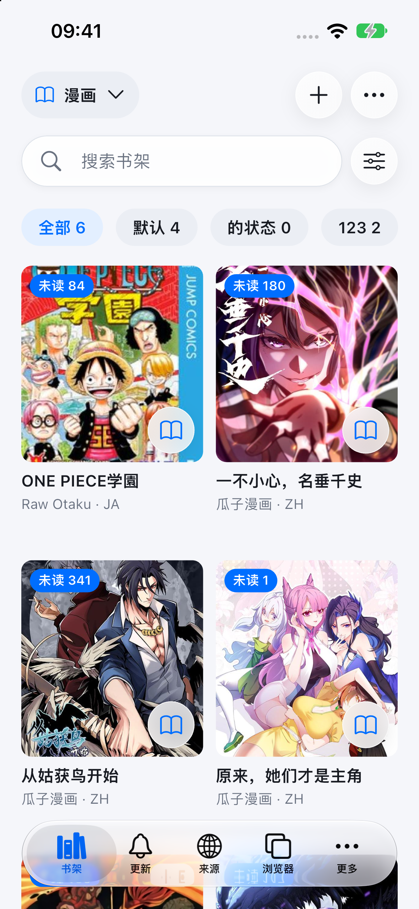
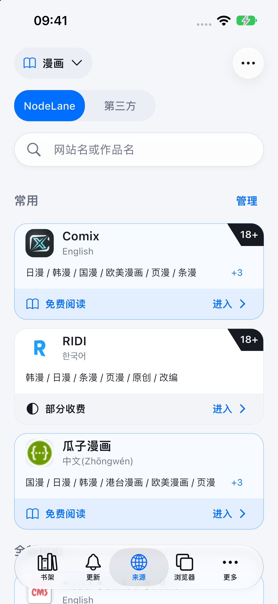

<picture>
  <source media="(prefers-color-scheme: dark)" srcset="docs/images/logo-horizontal-zh-dark.webp">
  
</picture>

**简体中文** | [English](README_EN.md)

**在手机上读漫画，随读随译。**

NodeLane 漫译是一款面向 iOS 和 Android 的漫画阅读与翻译应用，把书架、漫画来源和网页阅读放在一起，随时接着上次的进度看。

目前提供 **Android 安装包**，支持 Android 7.0 及以上，普通手机优先选择 `arm64-v8a`。iOS 版尚未公开发行。

## 使用体验

- **查找与收藏**：浏览漫画来源、跨站搜索，把想看的作品加入书架。
- **自在阅读**：连续滚动、单页或双页阅读，记住阅读进度。
- **随读随译**：登录 NodeLane 账号后翻译漫画图片，随时切回原图。
- **多标签浏览**：在内置浏览器打开网站，阅读并翻译网页中的漫画。

## 界面预览

| 书架 | 漫画来源 | 阅读器 |
| :--: | :--: | :--: |
|  |  |  |

截图来自 iOS 模拟器中的实际运行界面。漫画内容与封面版权归各自权利人所有。

## 开源许可

基于 [Mangayomi](https://github.com/kodjodevf/mangayomi)，保留上游 [Apache-2.0 许可](LICENSE)与[来源声明](UPSTREAM.md)。NodeLane 品牌素材沿用 `GPL-3.0-only`，详见[素材来源与许可](docs/design/nodelane-brand-assets.md)。
