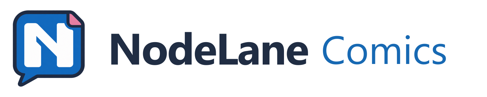
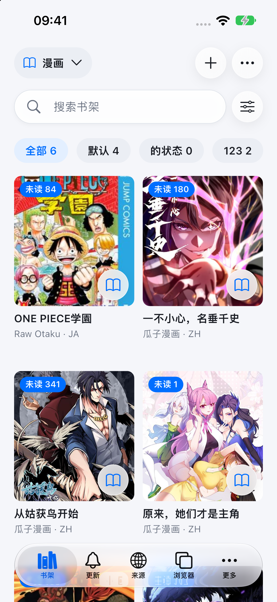
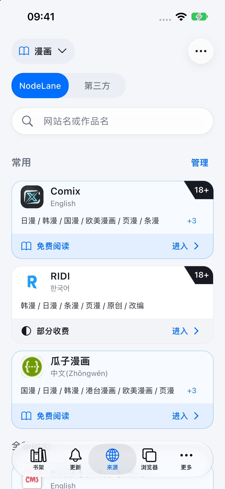
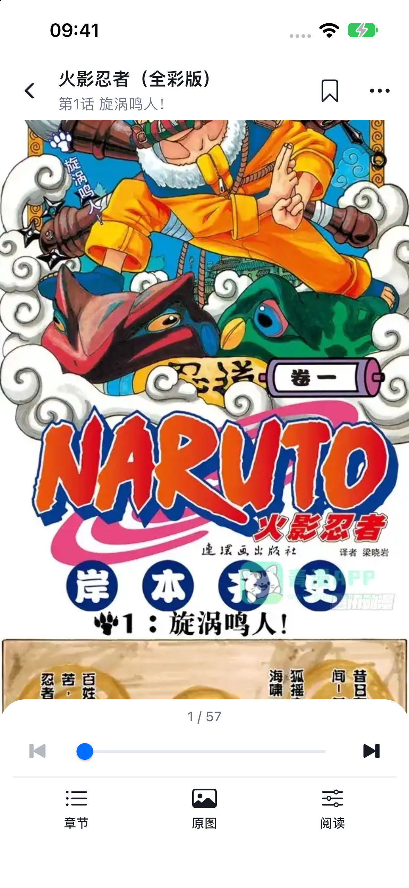

<picture>
  <source media="(prefers-color-scheme: dark)" srcset="docs/images/logo-horizontal-en-dark.webp">
  
</picture>

[简体中文](README.md) | **English**

**Read comics on your phone. Translate as you go.**

NodeLane Comics is a comic reader and translator for iOS and Android. Keep your library, comic sources, and web reading in one place, and pick up where you left off.

**Android downloads** are available for Android 7.0 and later. Choose `arm64-v8a` for most phones. The iOS version is not yet publicly available.

## Features

- **Discover and collect**: Browse comic sources, search across sites, and add titles to your library.
- **Read your way**: Choose continuous scrolling, single pages, or double pages, with your reading progress saved.
- **Translate as you read**: Sign in to your NodeLane account to translate comic images and switch back to the originals at any time.
- **Browse in tabs**: Open websites in the built-in browser to read and translate web comics.

## Screenshots

| Library | Comic sources | Reader |
| :--: | :--: | :--: |
|  |  |  |

Captured from the app running in the iOS Simulator with the Chinese interface. Comic content and cover art belong to their respective rights holders.

## License

Based on [Mangayomi](https://github.com/kodjodevf/mangayomi), with its [Apache-2.0 license](LICENSE) and [upstream attribution](UPSTREAM.md) retained. NodeLane brand assets retain their `GPL-3.0-only` license; see [asset sources and licensing](docs/design/nodelane-brand-assets.md).
