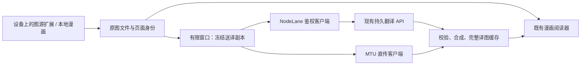

# NodeLane App 对接

本文维护独立 App 的实现范围和接入方案。账号客户端与页面已接入，Logto native client 已登记；真实移动端登录仍需实际账户验收。翻译功能仍是设计，表中“现有”指同级 Node Comics 已有接口或 Mangayomi 已有接点。

## 1. 范围与契约入口

目标为 Android 与 iOS 共用 Flutter 业务实现、分别完成平台验收。首版包含漫画图源、下载与离线阅读、NodeLane 登录、官方常规翻译、MTU 渠道、原译切换和任务恢复。

书架、阅读进度和译图缓存由 App 本机维护。手机与浏览器插件之间的二维码、链接接力及书架／进度／译图同步已移出项目范围。

一本漫画只绑定一个来源，来源目录只读。首版 UI 展示漫画范围，复用上游内容类型过滤；动漫、小说和其他扩展格式不进入兼容承诺。JS 图源优先，在设备上安装并运行；Dart 等格式按真机验证结果纳入。无需为首版新增 DEX / JVM / WASM 兼容层。

服务端规则直接引用同级工程的唯一规范：

| 权威来源 | 用途 |
| --- | --- |
| [OpenAPI](https://github.com/Wy2926/node-comics/blob/main/contracts/openapi.json)、[导出规则](https://github.com/Wy2926/node-comics/blob/main/contracts/README.md) | 请求／响应 schema 和错误 |
| [生产身份](https://github.com/Wy2926/node-comics/blob/main/docs/PRODUCTION_IDENTITY.md) | OIDC、续期与账号隔离 |
| [翻译契约](https://github.com/Wy2926/node-comics/blob/main/docs/READING_TRANSLATION_CONTRACT.md) | UUID、输入、覆盖结果、恢复和阅读窗口 |
| [翻译渠道](https://github.com/Wy2926/node-comics/blob/main/docs/TRANSLATION_CHANNELS.md) | 官方与 MTU 的差异 |
| [计算协议](https://github.com/Wy2926/node-comics/blob/main/docs/COMPUTE_PROTOCOL.md)、[存储规则](https://github.com/Wy2926/node-comics/blob/main/docs/OBJECT_STORAGE.md) | 分块格式、原图与结果寿命 |
| [会员额度](https://github.com/Wy2926/node-comics/blob/main/docs/MEMBERSHIP_AND_QUOTAS.md) | 权益、用量与结算 |

以上链接指向 Node Comics 的当前规范。本机需要联调或核对服务端代码时，将两个仓库同级克隆。文档与代码不符时先核对 API 路由和 OpenAPI，修正唯一规则，不在 App 文档维护另一套后端协议。



## 2. 最小代码接入点

| 现有模块 | 实现位置与要求 |
| --- | --- |
| [图源调度](../lib/eval/lib.dart)、[JS 扩展](../lib/eval/javascript/service.dart) | 继续负责搜索、目录、页列表和来源 headers；NodeLane 凭据不注入此客户端。 |
| [章节页读取](../lib/services/get_chapter_pages.dart) | 保留先查下载文件、再访问图源的顺序；已下载章节不依赖图源在线。 |
| [图片扩展方法](../lib/utils/extensions/others.dart) | 复用 `getLocalFilePath` / `getImageBytes`，优先文件读流；显示选择同时覆盖文件路径和 `getImageProvider`。 |
| [分页图片](../lib/modules/manga/reader/image_view_paged.dart)、[阅读内容](../lib/modules/manga/reader/widgets/reader_page_content.dart) | 接入原图／完整译图选择，兼容长图、宽页切分、缩放与连续阅读。只替换 ImageProvider 会漏掉按文件路径分块显示的分支。 |
| [页显示状态](../lib/modules/manga/reader/u_chap_data_preload.dart) | 切换后更新 `resolvedFilePath`、尺寸、`srcRect` 与解码状态，保留来源身份及阅读锚点，释放旧图。 |
| [图片动作](../lib/modules/manga/reader/widgets/image_actions_dialog.dart) | 首次贯通使用当前页翻译入口；自动翻译之后由可见页窗口驱动。 |
| [现有 repositories](../lib/repositories)、[数据模型](../lib/models) | 沿用数据库与写入队列；新增账号作用域的任务回执、输入文件引用与译图记录，凭据使用安全存储。 |
| [路由](../lib/router/router.dart)、[启动入口](../lib/main.dart) | 接账号和翻译任务入口；配置原生登录回调。 |

新增业务集中在 `lib/modules/nodelane/`。目前已实现账号会话、独立官方 HTTP 客户端与账号页；翻译协调与结果读取进入对应阶段再实现。

官方与 MTU 共用阅读入口、完整译图显示和缓存，内部只保留实际需要的两种执行路径。官方有账号及 UUID 持久任务，MTU 为直传长请求，不能强行用同一恢复协议。

## 3. NodeLane 账号

账号客户端默认服务为 `https://comics.nodelane.net`。公开 `/v1/auth/config` 已核实使用 `https://auth.nodelane.net/oidc` issuer 和 `https://comics.nodelane.net/api` resource；移动客户端读取服务配置，不使用其中的浏览器 client ID。

### 移动端配置与当前实现

| 项目 | 处理 |
| --- | --- |
| Logto 应用 | 已登记独立 native / public 应用“NodeLane Comics App”，公开 client ID 为 `pljp89y5gk6k5x2h9gp6q`，作为默认配置；可用 `NODELANE_CLIENT_ID` 编译参数覆盖，显式置空时禁用登录。 |
| 身份与资源 | 复用现有 issuer、API resource / audience，不能用 client ID 替代 audience。 |
| Android / iOS 身份与回调 | App ID 为 `net.nodelane.comics`；平台和 Logto 均已登记 `net.nodelane.comics://oauth/callback`。保留上游 tracker 的独立回调。 |
| 授权方式 | 系统浏览器 Authorization Code + PKCE S256；请求 `openid profile offline_access` 和 API resource。 |
| 凭据 | App 不持有 client secret；访问／刷新令牌放 Keychain / Android 安全存储。 |

`GET /v1/auth/config` 当前返回浏览器／插件 client ID，不能直接作为移动端 client ID。原生客户端复用同一 issuer / subject 后，后端映射到同一个 NodeLane 用户，沿用会员和额度；无需复制用户表或自建扣量逻辑。参考 [Logto 官方 Flutter 集成](https://docs.logto.io/quick-starts/flutter)。移动应用由用户授权登记，原浏览器应用配置保持现有值。

在“更多 → NodeLane 账号”登录、刷新会员与常规翻译额度、退出或切换账号。使用现有 `flutter_web_auth_2` 打开系统浏览器，PKCE 使用 `crypto`；安全存储独立于数据库与 App 书架备份。Android 禁用系统备份并排除 shared preferences 设备迁移；iOS 使用本 App 的 Keychain group 和不进入备份的 `passcode` 可访问类别，设备必须设置锁屏密码，保存失败时不降级存储。参考 [Apple Keychain 数据保护](https://support.apple.com/zh-cn/guide/security/secb0694df1a/1/web/1)。Windows 只能验证 Android，iOS 平台仍需 Mac 与真机。

本地启动使用[Android 脚本](../scripts/android.ps1)，默认公开 native client ID 已可直接使用，`-ClientId` 用于覆盖。公开配置参数为 `NODELANE_SERVICE_ORIGIN`、`NODELANE_CLIENT_ID`、`NODELANE_REDIRECT_URI`；自定义回调时还必须同步修改平台 handler 和 Logto 登记值。不得传入 client secret 或用户令牌。

登录后调用 `GET /v1/me`，响应为 `{user, entitlements}`，验证身份成功后建立会话。业务能力读取 `/v1/capabilities`。同一会话只允许一个刷新流程；先保存轮换后的凭据，再继续业务请求。

- 请求 401：最多刷新一次，以原 body 和 UUID 重放一次；重放仍返回 401，或身份端明确拒绝刷新才清会话。重放遇到网络错误、429 或 5xx 仍保留会话。
- 403：展示权限错误，保留会话。429、5xx、网络失败：保留凭据并退避，不把暂时断网视为退出。
- 退出／切换账号：以会话 ID 阻止迟到响应写回旧会话；任务和译图按服务 origin + issuer + subject 隔离。保留原图与位置，已受理的后端任务继续存在。
- 源站 headers / Cookie、MTU 凭据和 NodeLane Bearer 分属不同客户端；OAuth callback、令牌和图片内容不记录到默认日志。

## 4. 官方翻译接口

所有翻译业务请求，包括 SSE、结果下载、取消、删除、反馈和详情，均携带：

```http
Authorization: Bearer <access_token>
X-Translation-Protocol: overlay-v1
```

| 操作 | 现有接口 |
| --- | --- |
| 用户／权益／能力 | `GET /v1/me`、`GET /v1/me/entitlements`、`GET /v1/capabilities` |
| 用量 | `GET /v1/me/usage`、`GET /v1/me/usage/summary` |
| 创建 | `PUT /v1/translations/{UUID}`，JSON 描述 |
| 补传 | `PUT /v1/translations/{UUID}/input`，实际送译二进制 body，非 multipart |
| 恢复 | `GET /v1/translations/{UUID}`、`GET /v1/translations?ids=…` |
| 状态订阅 | `GET /v1/translations/events?ids=…`，SSE |
| 结果 | `GET /v1/translations/{UUID}/result` |
| 取消／撤销 | `POST /v1/translations/{UUID}/cancel`、`DELETE /v1/translations/{UUID}` |
| 反馈／文字详情 | `POST /v1/translations/{UUID}/feedback`、`GET /v1/translations/{UUID}/classic` |

创建请求示例只表示字段形状，摘要与大小必须来自落盘后的真实送译文件：

```json
{
  "image": {
    "sha256": "<实际送译字节的小写 SHA-256，共 64 个十六进制字符>",
    "byte_size": 123456,
    "content_type": "image/webp",
    "normalization_version": 1
  },
  "mode": "classic",
  "target_language": "zh-Hans"
}
```

首版只提交 `classic`，对齐当前浏览器插件。后端仍有 redraw 能力，不等于 App 首版要启用。语言、权益、`max_bytes`、`max_dimension` 和结果格式读取 capabilities；不硬编码历史服务限制，不提交书目、页码、客户端页键、旧 `priority` 或自算扣费上限。

### 请求落盘与恢复

一个本地回执保存账号／渠道作用域、页面身份、UUID、完整业务描述、来源摘要、冻结输入路径／摘要／尺寸／编码策略和结果描述。凭据单独安全保存，不进入回执、图片备份或作用域键。

1. 从同一来源取得原图，冻结实际送译字节；文件写完并持久保存回执后才提交创建。
2. 服务端返回 `needs_input` 时上传原 UUID 的冻结文件；其他状态不盲目补传。
3. 失联、进程终止或未知创建响应后，先 GET 原 UUID。只有明确 404 才以同 UUID 重放原描述；401、网络失败和批量查询失败都不是 404。
4. 恢复 `needs_input` 时仍使用原字节。冻结文件缺失且无法严格恢复原摘要时，停止补传并显示恢复失败；来源变更显示 `SOURCE_CHANGED`。
5. 同账号同 UUID 绑定不可变输入。同账号相同输入可由后端复用计算与结果，App 不维护第二套计费去重。
6. 明确失败后的手动重试使用新 UUID + `{"retry_of":"<旧UUID>"}`；成功结果手动重译使用 `{"regenerate_of":"<旧UUID>"}`。这两种 body 不同时带普通 image / mode / language，结果格式由后端继承。

远端状态为 `needs_input / queued / running / succeeded / failed / needs_attention`。本地“准备／上传／保存结果”状态独立展示；`needs_attention` 表示待核实，不自动重新提交。取消是否完成以服务端快照为准，“停止状态订阅”不能显示成“后端已停止”。

批量查询和 SSE 每批最多 32 UUID，同时遵守 capabilities。活跃阅读器共用一个有界订阅协调器；重连先批量核实，退避并遵守 Retry-After。恢复前台只查当前页和本地未完成回执，不扫描全账号历史。后台／断网停止新增送译和订阅；已受理后端任务继续执行，回到前台按原 UUID 恢复。

### 图片与结果

原图读取与翻译准入分开：服务上传限制不能改写或缩小阅读原图。静态首帧、EXIF 方向、sRGB 语义保持与现行契约一致，来源摘要和实际送译摘要分开保存。

App 的送译副本按现行 `short-edge-1800-webp90-jpeg30-v2` 语义实现：短边最多 1800、不放大小图，必要时单次 WebP 0.90，超出 WebP 编码边长时按契约使用 JPEG 0.30；完整分支、格式限制与无收益编码处理以[翻译契约](https://github.com/Wy2926/node-comics/blob/main/docs/READING_TRANSLATION_CONTRACT.md)为准。移动编码器须验证首帧／方向／色彩、透明区域和实际宽高，不能把 Dart 与浏览器相同质量参数当作相同字节。每次新请求以实际文件计算摘要，恢复禁止更换编码器后改写冻结摘要。

| representation | App 处理 |
| --- | --- |
| `overlay-v1` | 下载裁剪的 RGBA 无损 WebP，校验 bbox，以 `source-atop` 在冻结送译尺寸合成。 |
| `overlay-tiles-v1` | 仅在能力声明后冻结请求 `result_format`；按实际响应读取有界清单和连续 WebP 块，校验整包／每块摘要、尺寸、不重叠范围及完整长度，逐块释放。**不是 ZIP。** |
| `original` | 无文件，不下载；显示原图。无字或无可见变化均不能自动重译。 |

完整译图必须在送译尺寸合成，不能把缩小后的覆盖层放大贴到高分辨率原图。先校验 input SHA、规范化版本、尺寸、artifact MIME／长度／SHA 和所属 UUID，再显示、缓存或导出；网络客户端只允许配置中心 origin 的该 UUID 结果路径，不自动跟随重定向、不使用查询令牌或签名 URL。

结果合成的 Flutter / Rust 选择由代表性页基准决定。复用已有 Rust 桥和 `image` 等依赖前，确认 WebP alpha、`source-atop` 语义和长图编码能力，不能用普通 alpha blend 默默替代。条漫需要受内存预算约束的分带处理；未通过大图验收前不可宣称任意长图可用。

成功后持久保存校验后的完整译图，再次阅读直接读文件。下载／解码失败保持任务成功，仅重读同 UUID 结果；不触发模型重译。服务端原图到任务终态会清理，App 要保留自己的原图恢复路径和冻结副本策略，不能向中心请求永久原图。切换原／译图时保留页号、连续阅读锚点、缩放与宽页切分状态。

## 5. MTU 渠道

按[既有渠道契约](https://github.com/Wy2926/node-comics/blob/main/docs/TRANSLATION_CHANNELS.md)实现 `POST /auth/login`，再用 `X-Session-Token` 调用 `POST /translate/with-form/image`，multipart 包含 `image` 与 JSON 字符串 `config`；目标语言使用 MTU 的 `config.translator.target_lang` 代码。

MTU 无需 NodeLane 登录或额度，结果是完整图片。渠道凭据存入安全存储并绑定服务配置；同渠道串行执行。超时、App 被终止或未知响应提示手动重试，不自动重放、不假定远端停止，不套用官方 UUID／SSE 恢复。修改服务配置或切换渠道后，迟到结果只能写入原作用域。

手机的 `127.0.0.1` 指向手机本身，不能沿用桌面本机地址。连接局域网服务需真实可达地址；Android cleartext 与 iOS ATS / 本地网络权限按明确目标配置、真机验证，不能全局关闭传输保护。

## 6. UI、窗口与性能

界面先围绕书架、图源、任务、账号四个入口组织。沿用上游布局、主题与阅读器，按需引入 NodeLane 颜色和文案；品牌色参考[现有主题](https://github.com/Wy2926/node-comics/blob/main/apps/extension/src/ui/theme/tokens.css)。阅读工具栏展示渠道、目标语言、当前页状态与原译切换，失败操作留在当前页，不阻塞原图阅读。

自动翻译以当前页优先，加随后最多三页；读取当前有限窗口，沿用[现行窗口规则](https://github.com/Wy2926/node-comics/blob/main/docs/READING_TRANSLATION_CONTRACT.md)。滚动移出窗口取消尚未提交的准备，已经受理的后台任务仍按 UUID 保存。准备／合成串行，网络并发有界；具体并发与缓存预算先用真机数据确定，不一次解码所有窗口页面。

3000 × 4500 的一份 RGBA 像素约 51.5 MiB；原图、送译图、覆盖图和画布共存会叠加。优先文件引用与读流，像素处理放到后台 isolate 或既有 Rust 路径；一次处理一个工作集，释放临时解码，完整译图用文件缓存。不加入全章扫描或永久无界内存缓存。

性能验收比较同一设备上的上游阅读基线、App 关闭翻译、开启翻译、缓存重开四种路径，记录首屏／当前页可读时间、准备与合成耗时、峰值 RSS、帧耗时、请求数和上传量。样本含普通页、4K 页、一般条漫与宽页；缓存命中不得重复创建请求或合成。新增阅读延迟和内存上限在基线测量后确定，当前未测量。

## 7. 实施阶段与验收

以下为一名熟悉 Flutter 与现有后端的开发者的工程估算，约 41–62 个工作日（8–13 个全职工作周）；不是交付承诺。Mac／真机、登录配置、依赖下载、代表图源可用性影响进度，应用商店审核等待另计。

| 阶段 | 工作量估算 | 可交付结果与通过条件 |
| --- | --- | --- |
| M0 双端基线 | 3–5 日 | 匹配并记录 SDK，Android / iOS debug 真机运行；自有应用身份与更新配置；一套 JS 图源、本地漫画、分页／连续阅读和位置恢复通过。 |
| M1 账号 | 5–7 日 | 原生 Logto 客户端与回调登记完成；真实登录、刷新轮换、退出／换账号、断网和 401 恢复通过，旧账号请求不会写入新账号。 |
| M2 官方翻译 | 15–22 日 | 当前页创建→上传→SSE→校验→合成→缓存贯通；单文件／分块／original、宽页和条漫通过；未知结果恢复使用同 UUID，重复执行和隔离正确。 |
| M3 渠道与界面 | 8–12 日 | MTU 真服务贯通、渠道切换和中断行为通过；有限预取、任务页、原译切换不改变位置；双端内存与阅读延迟完成基准。 |
| M4 稳定与发行准备 | 10–16 日 | 生命周期、存储淘汰、权限、失败和恢复回归；自有 Android / iOS 安装包验收，许可清单、隐私说明与发布工作流完成。 |

首个贯通目标先完成 M0、M1 和 M2 的单页普通覆盖路径，在两端都跑通后再增加分块、窗口与完整 UI；不能拿 Android 单端效果代替双端验收。

### 验证层次

- 单测／模拟 API：协议校验、同 UUID 恢复、token 轮换、账号隔离、非法覆盖包、缓存与位置状态。
- 真实服务：真实 OIDC、实际 NodeLane 任务和额度、MTU 请求、图源与 Cookie 登录；记录发生的调用，不以夹具响应替代。
- 双端真机：冷／热启动、后台／杀进程／恢复、低内存、原译切换、条漫与切分页、文件导入。
- 模型效果与发行：译文和绘制效果单独检查；构建、签名、安装、商店审核和线上发布分别报告。

账号核心与入口已经接入；实际编译与模拟器结果见 README 的当前状态。真实 OIDC、双端真机、翻译、模型与发行验收仍需分别完成。新增扩展格式按双端实测纳入，不能作为已有兼容能力列入首版完成状态。
