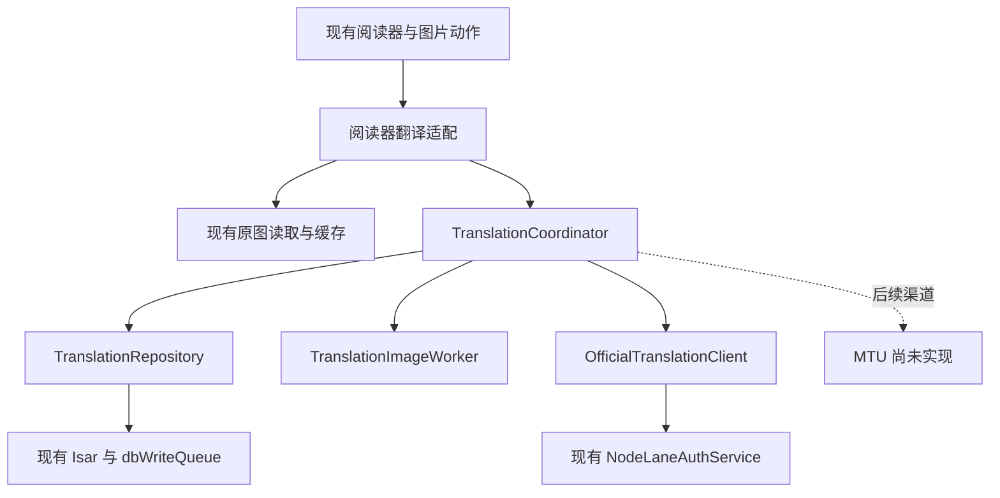

# NodeLane App 对接

本文维护独立 App 的当前实现与接入边界。账号、官方常规翻译、有限阅读窗口和原译切换已接入；Android 模拟器使用线上已登录账号完成翻译、恢复和完整译图缓存联调。MTU 为后续范围，iOS 与双端真机尚未验收。

## 1. 范围与契约入口

目标为 Android 与 iOS 共用 Flutter 业务实现、分别完成平台验收。首版包含漫画图源、下载与离线阅读、NodeLane 登录、官方常规翻译、MTU 渠道、原译切换和任务恢复。

书架、阅读进度和译图缓存由 App 本机维护。手机与浏览器插件之间的二维码、链接接力及书架／进度／译图同步已移出项目范围。

一本漫画只绑定一个来源，来源目录只读。首版 UI 展示漫画范围，复用上游内容类型过滤；动漫、小说和其他扩展格式不进入兼容承诺。JS 图源优先，在设备上安装并运行；Dart 等格式按真机验证结果纳入。无需为首版新增 DEX / JVM / WASM 兼容层。

服务端规则直接引用同级工程的唯一规范：

| 权威来源 | 用途 |
| --- | --- |
| [OpenAPI](https://github.com/Wy2926/node-comics/blob/main/contracts/openapi.json)、[导出规则](https://github.com/Wy2926/node-comics/blob/main/contracts/README.md) | 请求／响应 schema 和错误 |
| [生产身份](https://github.com/Wy2926/node-comics/blob/main/docs/PRODUCTION_IDENTITY.md) | OIDC、续期与账号隔离 |
| [翻译契约](https://github.com/Wy2926/node-comics/blob/main/docs/READING_TRANSLATION_CONTRACT.md) | UUID、输入、覆盖结果、恢复和阅读窗口 |
| [翻译渠道](https://github.com/Wy2926/node-comics/blob/main/docs/TRANSLATION_CHANNELS.md) | 官方与 MTU 的差异 |
| [计算协议](https://github.com/Wy2926/node-comics/blob/main/docs/COMPUTE_PROTOCOL.md)、[存储规则](https://github.com/Wy2926/node-comics/blob/main/docs/OBJECT_STORAGE.md) | 分块格式、原图与结果寿命 |
| [会员额度](https://github.com/Wy2926/node-comics/blob/main/docs/MEMBERSHIP_AND_QUOTAS.md) | 权益、用量与结算 |

以上链接指向 Node Comics 的当前规范。本机需要联调或核对服务端代码时，将两个仓库同级克隆。文档与代码不符时先核对 API 路由和 OpenAPI，修正唯一规则，不在 App 文档维护另一套后端协议。

## 2. 翻译架构与最小接入点

当前沿用图源、章节、阅读进度、Isar、Riverpod、Rust 桥和账号会话；新增职责限于阅读器适配、官方翻译协调、图片处理和持久记录。MTU 待按独立渠道实现。服务端字段与恢复语义见第 4、5 节及权威契约。

### 2.1 当前代码与必要改动

| 现有模块 | 实现位置与要求 |
| --- | --- |
| [图源调度](../lib/eval/lib.dart)、[JS 扩展](../lib/eval/javascript/service.dart) | 继续负责搜索、目录、页列表和来源 headers；NodeLane 凭据不注入此客户端。 |
| [章节页读取](../lib/services/get_chapter_pages.dart) | 保留先查下载文件、再访问图源的顺序；已下载章节不依赖图源在线。 |
| [图片扩展方法](../lib/utils/extensions/others.dart)、[源图缓存](../lib/modules/widgets/custom_extended_image_provider.dart) | `getLocalFilePath` 可返回本地／下载／缓存文件；`getImageBytes` 缓存未命中时只等待再查，不主动下载。阅读器适配层提供完整的原图文件取得入口，复用现有 headers 合并、网络缓存和下载去重。 |
| [分页图片](../lib/modules/manga/reader/image_view_paged.dart)、[阅读内容](../lib/modules/manga/reader/widgets/reader_page_content.dart) | 接入原图／完整译图选择，兼容长图、宽页切分、缩放与连续阅读。只替换 ImageProvider 会漏掉按文件路径分块显示的分支。 |
| [页显示状态](../lib/modules/manga/reader/u_chap_data_preload.dart) | 原图引用与当前显示引用分开。`getLocalFilePath` 优先返回 `resolvedFilePath`，不能用译图路径覆盖该字段后再从它取送译原图。 |
| [图片动作](../lib/modules/manga/reader/widgets/image_actions_dialog.dart) | 首次贯通使用当前页翻译入口；自动翻译之后由可见页窗口驱动。 |
| [数据库初始化](../lib/providers/storage_provider.dart)、[写入队列](../lib/repositories/db_write_queue.dart) | 新增一个翻译记录集合和 repository；所有翻译元数据由主 isolate 沿用 `dbWriteQueue` 写入。图片 worker 不自行打开数据库或写事务。 |
| [已有工作池](../lib/services/isolate_service.dart)、[翻译 Rust API](../rust/src/api/translation_image.rs) | 图源池与阅读器解码池保留原职责。翻译复用 Rust 桥、`image`，使用 libwebp 编码和 moxcms 色彩转换；文件准备与覆盖合成共用串行图片队列。 |
| [路由](../lib/router/router.dart)、[启动入口](../lib/main.dart) | 接账号和翻译任务入口；配置原生登录回调。 |

现有压缩包阅读路径有整章解压为字节的分支，翻译接入只能按页使用其已有结果；这不代表压缩包已实现逐页懒加载。翻译模块不再建立一套压缩包读取器。

### 2.2 依赖方向与职责

下图箭头表示调用／依赖方向。只有阅读器适配层认识 `UChapDataPreload`、来源 headers 和布局，翻译核心通过文件引用与值对象工作。



| 单元 | 拥有的职责与最小输入／输出 |
| --- | --- |
| 阅读器翻译适配 | 将当前原页、阅读窗口与用户动作转成意图；提供按需取得原图文件的函数；观察页状态并选择显示引用。输入来自现有阅读器，输出为不可变页身份、文件引用与设置快照。 |
| `TranslationCoordinator` | 顺序组织查记录、准备、提交／恢复、读取结果；合并同页请求，管理有限窗口和一个有界官方订阅协调器。状态从持久记录投影，内存只保留在途 Future、订阅和窗口意图。 |
| `OfficialTranslationClient` | 封装官方逐图资源、文件传输和 SSE，只依赖已有鉴权请求入口。后续 MTU 使用独立客户端；官方 UUID 与 SSE 保留在官方路径。 |
| `TranslationImageWorker` | 冻结输入、规范化、校验、合成完整译图，准备与合成共用一条有界串行图片队列。输入／输出为路径、摘要、尺寸与处理策略；工作期间不访问图源、账号或数据库。MTU 冻结按其渠道要求处理，不默认套用官方编码策略。 |
| `TranslationRepository` | 唯一翻译记录与文件引用入口；负责事务去重、状态提交、原子文件发布、恢复查询和有界淘汰。大文件放私有目录，Isar 只保存元数据。 |

Riverpod 在[组合入口](../lib/modules/nodelane/translation/translation_provider.dart)创建对象并注入依赖。[阅读器适配](../lib/modules/manga/reader/providers/reader_translation_provider.dart)负责原图取得与显示选择，[阅读窗口](../lib/modules/manga/reader/providers/reader_translation_window.dart)仅保存当前最多四页的临时意图。[翻译协调器](../lib/modules/nodelane/translation/translation_coordinator.dart)组织执行，[一个 Isar 集合](../lib/models/translation_record.dart)同时保存任务回执和结果索引，[repository](../lib/repositories/translation_repository.dart)负责事务与完整译图发布。没有新增任务总线、图源客户端或第二套 token 管理。

翻译核心不接收 `WidgetRef`、`BuildContext`、`Chapter` 或 `PageUrl`；原图取得函数由阅读器侧注入，源站凭据留在该层。图源运行代码无需导入 NodeLane。先实现这两个实际渠道的具体方法，仅在出现重复行为时提取小函数，不引入渠道注册中心、通用任务引擎或额外事件总线。

### 2.3 页面、作用域与持久模型

**原页身份。** 本地 `pageKey` 是绑定来源身份、书目／章节的来源定位及章节内原页 `index` 的摘要；本地导入使用对应文件／容器与章节定位。漫画／章节数据库 ID 只供导航，不单独作为关联依据，因为书架恢复会重建并可能复用 ID。页列表的来源定位签名与原图 SHA-256 用于核验内容变化；私密定位只在设备上处理，不进入服务端任务描述或默认日志。阅读列表的 `pageIndex` 会随章节前插改变，宽页的 `srcRect` 是显示切片，二者均不参与任务身份。宽页两半共用一个整页任务。

首次准备以实际原图摘要建立关联。再次打开可读取已有原页关联及完整译图；页列表定位变化或重新取得原图后摘要变化时停止复用旧关联。无法核实新来源内容时可以显示已缓存版本，但不能把它标成新原图的译图；普通 UUID 的恢复仍只接受原冻结摘要。

**执行作用域。** 官方以 `NodeLaneAccount.scopeKey`（service origin + issuer + subject）、`official`、`classic` 和输入策略版本构成作用域摘要；目标语言另作为记录查询条件，实际结果格式随冻结输入保存。`sessionId` 仅用于会话变化后的迟到响应防护，登录续期不会使持久记录失效。后续 MTU 需按本地配置和凭据身份建立独立作用域。

**配置快照。** 当前持久保存完整创建描述和继承后的输入／语言／结果格式；策略版本参与作用域，运行中改语言只影响新意图。主题、原译显示开关和阅读位置不参与请求身份。后续增加可变渠道配置或升级合成格式时，需要扩展记录迁移和旧任务恢复；重建本地缓存仍读原 UUID。

retry / regenerate 明确针对原尝试，新记录按父任务继承并核实的模式、语言、输入与结果格式建立配置快照，不能套用用户当前已修改的设置。修改语言或输入策略后应走普通新翻译意图，避免旧配置结果进入新配置缓存。

首版新增一个 `TranslationRecord` 集合，每次尝试一条；同一记录同时承担任务回执与结果缓存索引，任务页和阅读器都读取它。

| 字段组 | 保存内容 |
| --- | --- |
| 关联与顺序 | 事务生成的自增 ID 作为尝试顺序、作用域、`pageKey`、来源定位签名、目标语言与完整描述。 |
| 不可变请求 | 官方 UUID 或 MTU 本地尝试 ID、请求种类与完整业务描述、来源摘要、冻结输入的路径／摘要／字节数／尺寸／编码与规范化版本。官方 retry / regenerate 保存父 UUID 和实际发送的互斥描述，继承的输入信息从服务端核实。 |
| 远端事实 | 官方最新快照与远端状态；MTU 保存可确认的请求结果或中断事实，不伪造官方 job 状态。 |
| 本地交付 | 本地处理阶段、脱敏错误类别、交付修订与取消意图、已验证结果描述、完整译图路径／摘要／尺寸／合成版本，或 `original` 标记；最后访问时间与文件字节数。 |

凭据、来源 headers 和图片字节不进集合。索引服务于当前作用域的未完成记录，以及 `(作用域, pageKey, 配置修订, 来源摘要)` 下的尝试顺序；文件落盘摘要与请求摘要来自同一冻结副本。

- 普通重复点击、自动窗口和宽页两半复用同一在途尝试。准备前先合并相同页意图，拿到原图摘要后在同一个 Isar 事务中“查询现有尝试 → 按需插入”；数据库约束不能只靠内存 Future。明确失败或待核实的尝试留给恢复／手动操作，窗口刷新不自动产生下一次尝试。
- 手动 retry / regenerate 创建下一条尝试，语义见第 4 节。展示选择按尝试创建序号取当前来源与配置下最新已校验、已发布的结果；新尝试尚未交付时仍可读上一次成功译图。较旧尝试迟到完成不能覆盖较新已交付结果。`original` 也是已就绪结果，不能跳过它继续显示旧译图；最新已交付译图被淘汰时恢复该尝试，期间显示原图，不重新选更早译图。
- 远端 `succeeded` 与本地“可读译图”独立。文件缺失或本地校验失败保留成功回执，重新读取同一结果；不能因显示失败生成新 UUID。不同原图摘要之间禁止退回旧译图。

每条记录只有一份远端快照和一份本地交付事实。UI 状态由二者计算，不额外持久化一套“任务列表状态”或“页面翻译状态”，也不另建 task、cache、page mapping 三套表。

SSE 与批量查询的快照通过同一提交入口更新，已确认终态不能被迟到的 queued / running 覆盖；取消后的最终判定以重新核实的快照为准。订阅优先覆盖当前窗口，其他未完成回执按第 4 节的上限分批核实，不要求单条 SSE 覆盖全部历史尝试。

### 2.4 文件提交、恢复与淘汰

原图继续使用现有下载／缓存路径，读取时取得稳定文件引用；冻结输入和完整译图进入 App 私有目录，由同一 repository 管理用途与预算。临时原图或归档页需要物化时按页处理，送译文件不能仅引用 system temp 或可被普通源图 LRU 删除的文件。

1. 图片 worker 写当前尝试的临时文件并完成校验、flush；协调器核对意图／会话，在 repository 提供的私有路径完成重命名，再经 repository 事务保存 UUID、不可变描述和冻结文件引用，成功后才能发送。写盘失败或磁盘预算不足，在创建远端任务前返回错误。
2. 官方按第 4 节提交／恢复；MTU 按第 5 节执行。两者均把本地显示失败与远端执行失败分开。官方手动 retry / regenerate 是引用父 UUID 的请求，输入继承按契约核实，不重新编码冒充父输入。
3. 结果先下载到当前交付修订专属的临时文件，经图片 worker 校验并生成完整译图，再由 repository 事务发布路径。发布前检查记录仍存在、交付修订未变且作用域／会话仍有效；清缓存、取消和删除先事务撤销引用或更新交付修订，再删文件，迟到 worker 的条件提交失败后回收其文件。文件发布与数据库不是跨系统原子事务，崩溃后按记录引用、有宽限期地清理孤儿文件；缺失的交付文件标为 `evicted`，按需恢复。
4. 未完成尝试和尚未保存完整结果的官方覆盖任务保护冻结输入；空间不足时停止新增准备。完整译图按文件字节数与访问时间有界淘汰，当前显示／处理中的文件暂时固定。清缓存保留回执并标记本地 `evicted`，仅当前窗口按需读取同 UUID；启动恢复不把所有被淘汰结果加入下载队列。删除任务、后端取消和退出账号是各自独立的用户动作。
5. 完整译图已持久保存后，冻结输入可按预算释放。译图与输入都已失去且来源无法严格还原原送译摘要时，显示恢复不可用并保留原图；用户明确选择新翻译才建立新尝试。缓存淘汰本身不触发模型调用。

取消先保存意图并更新交付修订，再调用渠道支持的操作。官方在结果未知时显示待确认，下一次快照决定最终执行状态；MTU 中断仅关闭本地请求。取消与本地清理均不能伪造远端终态。后续确实需要读取服务端已成功结果时，以新的交付修订重新开始。

主 isolate 复用 `dbWriteQueue`，数据库事务只处理元数据，网络请求和像素处理均在事务外执行。新增集合通过现有 `StorageProvider.initDB` 统一登记，图源 isolate 使用同一 schema 列表但不写翻译记录。备份沿用现有显式导出清单，翻译记录、冻结文件、译图与 MTU 凭据不加入书架备份或上游同步；iOS 文件另按平台规则排除系统备份。

### 2.5 鉴权与传输扩展

`NodeLaneAuthService.requestStream` 已统一 origin 限制、禁用重定向、401 单次续期重放和响应消费期间的会话防护。原有 `request` 复用它，账号逻辑没有另建 token 刷新流程。

上传以可重新打开的冻结文件流为 body 工厂，401 重放仍读取相同文件；下载直接写有界临时文件，SSE 逐条读取。等待响应头上限 2 分钟，流空闲上限 45 秒；翻译 JSON／SSE 单帧上限 2 MiB，错误响应只取至多 16 KiB 并保留安全类别。响应结束、后台切换和退出时关闭流，结果发布前再次核验会话与交付修订。翻译模块不读取 access token。

官方 API client 只将服务端快照／错误转换为本地值对象；计费、权益决策、计算去重、执行租约和原图寿命由后端管理。MTU 直接用独立客户端和安全存储，不通过官方鉴权入口转发。

### 2.6 阅读器显示与生命周期

阅读器侧维护一个显示引用，包含原页身份、当前文件／provider、实际显示尺寸、归一化裁切区域和显示修订。原图引用保持独立；显示修订仅用于清理旧解码与刷新布局，不属于翻译请求配置。

- 分页、连续和双页读取同一个选择结果，译图仍交现有解码器显示。`MinSubsamplingImage.didUpdateWidget` 当前依赖 data 对象变化，不能只原地改路径；文件路径、provider、尺寸和解码引用必须一起刷新。
- 宽页按归一化区域映射到原图／译图的实际尺寸，保持原页与左右切片。切换前捕获原页、页内归一化中心／偏移和相对最小缩放倍率；新图 ready 后利用现有 controller 恢复。现有进度仅保存章节内页号，精确切换锚点需在本次接入补齐，继续使用原进度系统。
- 阅读器 provider 只持有窗口意图与显示监听，可随页面 dispose。应用级协调器由已有账号／配置和前台生命周期驱动；阅读器退出释放窗口与订阅，不抹掉已受理任务的回执。当前首版只允许一个活跃漫画阅读窗口，不提前增加多阅读器调度。
- 原图／译图切换不创建任务。离开窗口停止尚未提交的准备；已受理任务由后端执行，前台恢复通过原 UUID 核实。退出或换账号沿用会话防护并立即移除旧账号译图显示；配置变化后的 MTU 迟到结果最多写入其原作用域，不能更新新窗口。

阅读窗口与性能预算见第 6 节。翻译窗口不复用原图预取队列作为任务引擎；两者只共享原图取得能力。准备与合成共用图片队列，上传和状态等待释放像素工作槽。

## 3. NodeLane 账号

账号客户端默认服务为 `https://comics.nodelane.net`。公开 `/v1/auth/config` 已核实使用 `https://auth.nodelane.net/oidc` issuer 和 `https://comics.nodelane.net/api` resource；移动客户端读取服务配置，不使用其中的浏览器 client ID。

### 移动端配置与当前实现

| 项目 | 处理 |
| --- | --- |
| Logto 应用 | 已登记独立 native / public 应用“NodeLane Comics App”，公开 client ID 为 `pljp89y5gk6k5x2h9gp6q`，作为默认配置；可用 `NODELANE_CLIENT_ID` 编译参数覆盖，显式置空时禁用登录。 |
| 身份与资源 | 复用现有 issuer、API resource / audience，不能用 client ID 替代 audience。 |
| Android / iOS 身份与回调 | App ID 为 `net.nodelane.comics`；平台和 Logto 均已登记 `net.nodelane.comics://oauth/callback`。保留上游 tracker 的独立回调。 |
| 授权方式 | 系统浏览器 Authorization Code + PKCE S256；请求 `openid profile offline_access` 和 API resource。 |
| 凭据 | App 不持有 client secret；访问／刷新令牌放 Keychain / Android 安全存储。 |

`GET /v1/auth/config` 当前返回浏览器／插件 client ID，不能直接作为移动端 client ID。原生客户端复用同一 issuer / subject 后，后端映射到同一个 NodeLane 用户，沿用会员和额度；无需复制用户表或自建扣量逻辑。参考 [Logto 官方 Flutter 集成](https://docs.logto.io/quick-starts/flutter)。移动应用由用户授权登记，原浏览器应用配置保持现有值。

在“更多 → NodeLane 账号”登录、刷新会员与常规翻译额度、退出或切换账号。使用现有 `flutter_web_auth_2` 打开系统浏览器，PKCE 使用 `crypto`；安全存储独立于数据库与 App 书架备份。Android 禁用系统备份并排除 shared preferences 设备迁移；iOS 使用本 App 的 Keychain group 和不进入备份的 `passcode` 可访问类别，设备必须设置锁屏密码，保存失败时不降级存储。参考 [Apple Keychain 数据保护](https://support.apple.com/zh-cn/guide/security/secb0694df1a/1/web/1)。Windows 只能验证 Android，iOS 平台仍需 Mac 与真机。

本地启动使用[Android 脚本](../scripts/android.ps1)，默认公开 native client ID 已可直接使用，`-ClientId` 用于覆盖。公开配置参数为 `NODELANE_SERVICE_ORIGIN`、`NODELANE_CLIENT_ID`、`NODELANE_REDIRECT_URI`；自定义回调时还必须同步修改平台 handler 和 Logto 登记值。不得传入 client secret 或用户令牌。

登录后调用 `GET /v1/me`，响应为 `{user, entitlements}`，验证身份成功后建立会话。业务能力读取 `/v1/capabilities`。同一会话只允许一个刷新流程；先保存轮换后的凭据，再继续业务请求。

- 请求 401：最多刷新一次，以原 body 和 UUID 重放一次；重放仍返回 401，或身份端明确拒绝刷新才清会话。重放遇到网络错误、429 或 5xx 仍保留会话。
- 403：展示权限错误，保留会话。429、5xx、网络失败：保留凭据并退避，不把暂时断网视为退出。
- 退出／切换账号：以会话 ID 阻止迟到响应写回旧会话；任务和译图按服务 origin + issuer + subject 隔离。保留原图与位置，已受理的后端任务继续存在。
- 源站 headers / Cookie、MTU 凭据和 NodeLane Bearer 分属不同客户端；OAuth callback、令牌和图片内容不记录到默认日志。

## 4. 官方翻译接口

所有翻译业务请求，包括 SSE、结果下载、取消、删除、反馈和详情，均携带：

```http
Authorization: Bearer <access_token>
X-Translation-Protocol: overlay-v1
```

| 操作 | 现有接口 |
| --- | --- |
| 用户／权益／能力 | `GET /v1/me`、`GET /v1/me/entitlements`、`GET /v1/capabilities` |
| 用量 | `GET /v1/me/usage`、`GET /v1/me/usage/summary` |
| 创建 | `PUT /v1/translations/{UUID}`，JSON 描述 |
| 补传 | `PUT /v1/translations/{UUID}/input`，实际送译二进制 body，非 multipart |
| 恢复 | `GET /v1/translations/{UUID}`、`GET /v1/translations?ids=…` |
| 状态订阅 | `GET /v1/translations/events?ids=…`，SSE |
| 结果 | `GET /v1/translations/{UUID}/result` |
| 取消／撤销 | `POST /v1/translations/{UUID}/cancel`、`DELETE /v1/translations/{UUID}` |
| 反馈／文字详情 | `POST /v1/translations/{UUID}/feedback`、`GET /v1/translations/{UUID}/classic` |

创建请求示例只表示字段形状，摘要与大小必须来自落盘后的真实送译文件：

```json
{
  "image": {
    "sha256": "<实际送译字节的小写 SHA-256，共 64 个十六进制字符>",
    "byte_size": 123456,
    "content_type": "image/webp",
    "normalization_version": 1
  },
  "mode": "classic",
  "target_language": "zh-Hans"
}
```

首版只提交 `classic`，对齐当前浏览器插件。后端仍有 redraw 能力，不等于 App 首版要启用。语言、权益、`max_bytes`、`max_dimension` 和结果格式读取 capabilities；不硬编码历史服务限制，不提交书目、页码、客户端页键、旧 `priority` 或自算扣费上限。

### 请求落盘与恢复

一个本地回执保存账号／渠道作用域、页面身份、UUID、完整业务描述、来源摘要、冻结输入路径／摘要／尺寸／编码策略和结果描述。凭据单独安全保存，不进入回执、图片备份或作用域键。

1. 从同一来源取得原图，冻结实际送译字节；文件写完并持久保存回执后才提交创建。
2. 服务端返回 `needs_input` 时上传原 UUID 的冻结文件；其他状态不盲目补传。
3. 失联、进程终止或未知创建响应后，先查询原 UUID。只有单项明确 404／`NOT_FOUND`，或批量成功响应明确列入 `missing_ids`，才以同 UUID 重放原描述；401、网络失败和批量查询整体失败均不表示未受理。
4. 恢复 `needs_input` 时仍使用原字节。冻结文件缺失且无法严格恢复原摘要时，停止补传并显示恢复失败；来源变更显示 `SOURCE_CHANGED`。
5. 同账号同 UUID 绑定不可变输入。同账号相同输入可由后端复用计算与结果，App 不维护第二套计费去重。
6. 明确失败后的手动重试使用新 UUID + `{"retry_of":"<旧UUID>"}`；成功结果手动重译使用 `{"regenerate_of":"<旧UUID>"}`。这两种 body 不同时带普通 image / mode / language，结果格式由后端继承。

远端状态为 `needs_input / queued / running / succeeded / failed / needs_attention`。本地“准备／上传／保存结果”状态独立展示；`needs_attention` 表示待核实，不自动重新提交。取消是否完成以服务端快照为准，“停止状态订阅”不能显示成“后端已停止”。

SSE 每批最多 32 UUID。当前客户端最多保留 32 条待处理回执，达到上限先同步或取消现有任务；前台共用一个 SSE 连接，断开后逐项查询同 UUID，退避并遵守 Retry-After。任务页显示最近 100 条记录，恢复查询单独读取未完成记录。后台停止新增送译和订阅；已受理后端任务继续执行，回到前台按原 UUID 恢复。

### 图片与结果

原图读取与翻译准入分开：服务上传限制不能改写或缩小阅读原图。静态首帧、EXIF 方向、sRGB 语义保持与现行契约一致，来源摘要和实际送译摘要分开保存。

App 的送译副本按现行 `short-edge-1800-webp90-jpeg30-v2` 语义实现：短边最多 1800、不放大小图，必要时单次 WebP 0.90，超出 WebP 编码边长时按契约使用 JPEG 0.30；完整分支、格式限制与无收益编码处理以[翻译契约](https://github.com/Wy2926/node-comics/blob/main/docs/READING_TRANSLATION_CONTRACT.md)为准。移动编码器须验证首帧／方向／色彩、透明区域和实际宽高，不能把 Dart 与浏览器相同质量参数当作相同字节。每次新请求以实际文件计算摘要，恢复禁止更换编码器后改写冻结摘要。

| representation | App 处理 |
| --- | --- |
| `overlay-v1` | 下载裁剪的 RGBA 无损 WebP，校验 bbox，以 `source-atop` 在冻结送译尺寸合成。 |
| `overlay-tiles-v1` | 仅在能力声明后冻结请求 `result_format`；按实际响应读取有界清单和连续 WebP 块，校验整包／每块摘要、尺寸、不重叠范围及完整长度，逐块释放。**不是 ZIP。** |
| `original` | 无文件，不下载；显示原图。无字或无可见变化均不能自动重译。 |

完整译图必须在送译尺寸合成，不能把缩小后的覆盖层放大贴到高分辨率原图。先校验 input SHA、规范化版本、尺寸、artifact MIME／长度／SHA 和所属 UUID，再显示、缓存或导出；网络客户端只允许配置中心 origin 的该 UUID 结果路径，不自动跟随重定向、不使用查询令牌或签名 URL。

当前使用既有 Rust 桥和 `image`：PNG／JPEG／WebP 输入，APNG／WebP 取动画首帧，处理 EXIF 方向与 RGB ICC。灰度／CMYK ICC 和其他编码返回格式错误，保留阅读原图。合成保留目标 alpha，整包和每块先校验再写入完整 PNG；tiles 逐块释放。当前底图使用一个 RGBA 缓冲，解码前限制 32 × 1024 × 1024 像素，这是本地工作集上限，不是服务端上传限制，也没有实现无限长图分带底图存储。

成功后持久保存校验后的完整译图，再次阅读直接读文件。下载／解码失败保持任务成功，仅重读同 UUID 结果；不触发模型重译。服务端原图到任务终态会清理，App 要保留自己的原图恢复路径和冻结副本策略，不能向中心请求永久原图。切换原／译图时保留页号、连续阅读锚点、缩放与宽页切分状态。

## 5. MTU 渠道

本节为后续接入约定，当前没有 MTU 客户端、设置或可用入口。

按[既有渠道契约](https://github.com/Wy2926/node-comics/blob/main/docs/TRANSLATION_CHANNELS.md)实现 `POST /auth/login`，再用 `X-Session-Token` 调用 `POST /translate/with-form/image`，multipart 包含 `image` 与 JSON 字符串 `config`；目标语言使用 MTU 的 `config.translator.target_lang` 代码。

MTU 无需 NodeLane 登录或额度，结果是完整图片。渠道凭据存入安全存储并绑定服务配置；同渠道串行执行。超时、App 被终止或未知响应提示手动重试，不自动重放、不假定远端停止，不套用官方 UUID／SSE 恢复。修改服务配置或切换渠道后，迟到结果只能写入原作用域。

手机的 `127.0.0.1` 指向手机本身，不能沿用桌面本机地址。连接局域网服务需真实可达地址；Android cleartext 与 iOS ATS / 本地网络权限按明确目标配置、真机验证，不能全局关闭传输保护。

## 6. UI、窗口与性能

沿用上游书架、图源与阅读器。阅读图片长按面板提供目标语言、页状态、原译切换、取消、明确重试与自动翻译开关；任务列表位于账号页。语言列表使用服务 capabilities 和已有语言名称表。失败状态留在当前页，不阻塞原图阅读。

自动翻译默认关闭，本次阅读启用后以当前原页优先、随后最多三页；宽页两半去重。移出窗口停止尚未提交的准备，已经受理的任务仍按 UUID 保存。准备意图最多 4 个，准备／合成共用串行像素队列，任务 I/O 两路并发，SSE 单连接。冻结输入预算 256 MiB、完整译图预算 512 MiB；当前显示／交付文件受保护。预算为保守初值，仍需真机调优。

3000 × 4500 的一份 RGBA 像素约 51.5 MiB；原图、送译图、覆盖图和画布共存会叠加。优先文件引用与读流，像素处理放到后台 isolate 或既有 Rust 路径；一次处理一个工作集，释放临时解码，完整译图用文件缓存。不加入全章扫描或永久无界内存缓存。

本机 Android API 36.1 x86_64 模拟器、debug 构建，合成测试图片的准备基准如下。RSS 每 10ms 采样，包含 Flutter／上游依赖和此前测试的进程内存；不是单独分配量，也不代表 release 真机表现。源图生成在另一个 isolate，计时只覆盖 Rust 准备调用。

| 样本 | 准备耗时 | 准备前／峰值 RSS | 实际输入 | 网络 |
| --- | --- | --- | --- | --- |
| 1000 × 1400 普通页 | 280 ms | 525.0／525.0 MiB | PNG，27,211 B | 0 |
| 3072 × 4096 4K 页 | 10,255 ms | 547.0／647.0 MiB | 1800 × 2400 WebP，52,488 B | 0 |
| 1000 × 18000 条漫 | 1,266 ms | 495.4／495.4 MiB | PNG，366,843 B | 0 |

分页原译切换的归一化中心／相对缩放、连续阅读偏移、宽页区域映射及快速切换检查已在该模拟器通过。上游基线对照、翻译期间滚动帧耗时、合成峰值、照片型漫画、release 与双端真机性能尚未测量；尤其 4K debug 准备耗时需要后续 release 真机验收，不能据此宣称大图性能已完成优化。

## 7. 当前验证与后续范围

| 层次 | 当前证据与剩余边界 |
| --- | --- |
| 协议／持久化 | 模拟 API + 真实 Isar 覆盖重复意图、未知创建响应、协调器重建、只重试下载、取消竞态、账号／语言隔离、继承重译和四页窗口。Rust 覆盖原字节冻结、source-atop 和 tiles 摘要／重叠／尺寸／尾部拒绝。 |
| 线上服务 | 使用 App 既有安全存储会话和生成图片，完成官方常规翻译、校验、完整译图保存、重建协调器与同 UUID 复用。没有把夹具响应当作生产调用。 |
| Android 阅读器 | 模拟器已通过宽页映射、分页中心／缩放、连续偏移、快速原译切换及窄屏控件检查；真实图源和真实手机还需验收。 |
| iOS | 共用 Dart／Rust 实现，私有译图目录加入系统备份排除；没有 Mac/Xcode 构建与真机证据。 |
| 后续功能 | MTU、翻译反馈／详情／删除入口、完整缓存管理 UI、自有图标／升级／发行配置尚未完成。 |

### 验证层次

- 单测／模拟 API：协议校验、同 UUID 恢复、token 轮换、账号隔离、非法覆盖包、缓存与位置状态。
- 真实服务：真实 OIDC、实际 NodeLane 任务和额度、MTU 请求、图源与 Cookie 登录；记录发生的调用，不以夹具响应替代。
- 双端真机：冷／热启动、后台／杀进程／恢复、低内存、原译切换、条漫与切分页、文件导入。
- 模型效果与发行：译文和绘制效果单独检查；构建、签名、安装、商店审核和线上发布分别报告。

运行命令见 [README](../README.md)。集成测试使用 `--no-uninstall` 保留本机安装和账号数据，线上测试需要显式开启 `NODELANE_LIVE_TEST`；测试后以正常入口重新安装运行。双端真机、模型效果与发行验收继续独立进行，新增图源格式按双端实测纳入。
