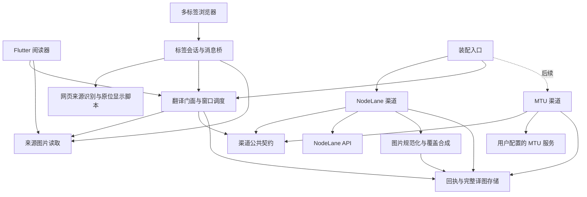

# 解耦漫画翻译架构

本文维护 **NodeLane 手机 App 的翻译架构、当前实现与验收边界**，面向 Android / iOS。代码基线与许可见 [UPSTREAM](../UPSTREAM.md)，产品约束见 [AGENTS](../AGENTS.md)。方案已获确认并进入实现；代码落地、模拟验证、构建成功与真机／真实服务可用分别记录，不能互相替代。

当前执行顺序以 iOS 为主，Android 构建、模拟器与真机测试暂缓；下文两平台契约与历史验证记录保留，Android 验收要求待恢复该平台工作后执行。首版产品取舍统一见[首版规划](MOBILE_UI_DESIGN.md#首版范围与发布顺序)。

## 当前实现与使用

| 边界 | 当前代码 |
| --- | --- |
| 来源、渠道与结果契约 | [contracts.dart](../lib/services/translation/contracts.dart)，展示端接收状态和可释放的本地图片；整图 FakeChannel 验证不依赖官方 UUID／SSE／覆盖图 |
| 官方渠道与恢复 | [channel.dart](../lib/services/translation/channels/nodelane/channel.dart)、[receipt.dart](../lib/services/translation/channels/nodelane/receipt.dart)、[http.dart](../lib/services/translation/channels/nodelane/http.dart)：冻结字节与请求，事务绑定 UUID，丢失响应先核实原 UUID，有界 SSE／退避，显式重试与重新翻译 |
| 持久化与图片工作 | [translation_repository.dart](../lib/repositories/translation_repository.dart) 使用独立、私有的 Isar 库；输入与结果预算、文件发布与缓存代次、租约释放分别执行。[image_work.dart](../lib/services/translation/image_work.dart) 串行 isolate 准备／合成，校验摘要、尺寸、bbox 与 alpha |
| 原生会话与组合入口 | [translation_service.dart](../lib/services/translation/translation_service.dart) 是具体渠道的组合入口；OIDC PKCE／续期在渠道内部。[nodelane_private_storage.dart](../lib/services/nodelane_private_storage.dart) 使用独立安全存储空间；[NodeLane.entitlements](../ios/Runner/NodeLane.entitlements) 在三种 iOS 构建配置中声明钥匙串能力，另有设备绑定钥匙串、私有目录备份排除及 Android 备份／迁移排除规则 |
| 阅读器 | [reader_translation.dart](../lib/modules/manga/reader/reader_translation.dart) 根据章节原始页身份更新窗口；译图采用独立显示数据，不覆盖来源页。单页保存归一化缩放中心，双页保留外层 controller，连续阅读订阅已有页码通知 |
| 手机网页 | [mobile_browser.dart](../lib/modules/webview/mobile_browser.dart)、[translation_bridge.dart](../lib/modules/webview/translation_bridge.dart)、[nodelane_reader.js](../assets/nodelane_reader.js)：最多 12 个逻辑标签，活动 1 个＋温存 1 个／30 秒，主框架与文档代次校验，HTTP／Blob 来源、128 KiB 确认传输、非交互覆盖层、图片锚点恢复 |

手机登录入口为“更多”首栏的软件账号；“更多 → 漫画翻译”或“设置 → 漫画翻译”管理目标语言与本机缓存，再从阅读器或浏览器工具栏手动开启翻译。此视图仍调用原服务，沿用登录、计费与渠道协议；布局与交互验收见[手机界面与视觉令牌](MOBILE_UI_DESIGN.md#翻译与账号设置)。每次打开新的网页标签默认不开始翻译；标签切回前台可以恢复原先已开启的阅读窗口。原图显示与暂停任务是两个控制项，已受理任务继续由后端执行。不同官方账号、服务与语言隔离；重新进入已有页面会核对当前原图摘要，定位地址相同不直接视为同一内容。

默认服务为 `https://comics.nodelane.net`，构建可用 `--dart-define=NODELANE_API_BASE=https://…` 指定兼容服务。手机账号入口位于“更多”首栏，翻译页保留语言与缓存设置；仍复用同一原生会话和渠道运行时。

移动登录默认使用独立 public client `pljp89y5gk6k5x2h9gp6q`，可由 `--dart-define=NODELANE_AUTH_CLIENT_ID=…` 覆盖；`/v1/auth/config` 提供身份端点与 API resource，返回的浏览器 `client_id` 不用于移动端。授权、换码及续期使用同一移动应用 ID，不嵌入 client secret。恢复时要求服务与应用 ID 都匹配；旧浏览器应用会话需要重新登录，翻译回执不删除。

系统浏览器 OAuth 回调默认为 **`mangayomi://nodelane-auth`**（无尾斜线），Android 回调 Activity 和 iOS URL Types 已接收 `mangayomi` Scheme。需在 Logto 上述应用的 Redirect URIs 中登记这一精确地址，并按[原生 Flutter 登录配置](https://docs.logto.io/quick-starts/flutter)使用 Native 应用及 Authorization Code + PKCE；`NODELANE_AUTH_REDIRECT` 变更时也需同步原生 URL Scheme。凭据只经原生安全存储与 HTTPS 客户端使用。用户已确认使用当前配置登录和翻译成功；该反馈未记录具体设备、阅读器／网页入口及测试范围，不等同于完整的真机、续期、换号或恢复验收。

普通主框架图片及页面可读 Blob 已实现。Canvas 取样代码由 `NODELANE_READABLE_CANVAS` 默认关闭，尚无站点稳定重绘映射，不作为可用能力；污染 Canvas、data URL、跨域 iframe、CSS 变换／cover 图形、16-bit／ICC／动画／AVIF、超预算图片和 tiles 结果均未开放。当前像素估算保守，部分高清普通页也会在受理前被拒绝；64 MiB 是新增工作预算，不是 App 总内存的实测保证。Cookie 按目标 URL 获取且跨站受限，SameSite／分区会话、移动 CSP、站点登录仍须真机验证。

验证入口集中在 [test/services/translation](../test/services/translation) 与现有阅读器测试，避免为每个 setter 添加镜像测试：

```sh
flutter analyze --no-fatal-infos --no-fatal-warnings
flutter test test/services/translation test/modules/manga/reader
python3 test/services/translation/browser_bridge_test.py
flutter build ios --debug --no-codesign
```

已执行的层次和未决项见文末；桌面 Chrome 夹具不等于 WKWebView／Android WebView 验收。

## 1. 推荐方案与首期边界

采用 **Flutter 统一调度与存储 + 独立渠道适配器 + 轻量网页脚本**：

- 漫画阅读器继续使用 Mangayomi 的来源、章节、图片与翻页体系；网页入口增加多标签管理，只把当前阅读图片交给同一个翻译服务。
- 来源负责发现和取图，渠道负责翻译协议与任务寿命，结果服务负责完整译图，展示端负责替换与位置。翻译公共层不认识站点、Cookie、官方扣费规则或 MTU 路径。
- 首期只交付 NodeLane 官方 `classic` 渠道，接现有逐图 API；使用合成的完整图片渠道测试替换边界。MTU 是已有协议的对照及后续可选任务，Shinobu 是已知候选，不在手机首期实现模型下载、ONNX 推理或本机执行宿主。
- 默认看原图，用户在原生界面开启翻译后才处理有限窗口。后台已受理任务独立完成；客户端暂停只停止本地工作。网页翻译不自动创建漫画或把全站图片加入书架。

不移植整套扩展运行时，不新增通用插件平台、工作流引擎或跨来源书目聚合。首期可读普通图片；需要登录、Canvas、长图分别通过后文的验收门槛开放，不能把普通图片通过当作全部来源可用。

## 2. 实际代码依据

### App 基线

核对的 HEAD 为 `34dea5fd450a4b4d7683a32bec31a9ba2f0b555d`（Mangayomi v0.9.9），分支为 `codex/nodelane-comics-app`。根 README、AGENTS、README.mangayomi 和 UPSTREAM 的初始化改动先于本文存在。

| 已有入口 | 核实到的行为 | 计划接法／注意事项 |
| --- | --- | --- |
| [get_chapter_pages.dart](../lib/services/get_chapter_pages.dart)、[page.dart](../lib/models/page.dart) | `getChapterPages` 优先已下载章节／归档和章节清单缓存，再调用来源 `getPageList`；`PageUrl` 只有 URL、headers、fileName | 包装为阅读器页面描述，不把翻译状态塞进 `PageUrl`，不改来源解析器 |
| [chapter_cache.dart](../lib/services/chapter_cache.dart) | 缓存页面清单，键为漫画 ID 与章节 URL；清单会序列化 headers | 清单不是图片内容身份，也不是翻译回执；新增翻译记录不得复制这些 headers |
| [u_chap_data_preload.dart](../lib/modules/manga/reader/u_chap_data_preload.dart) | 保留章节、原始页 index、本地路径、归档字节、`srcRect`、解码图和文件路径 | 原始页 index 可用于来源定位；合并章节后的数组 index 不可作为持久身份；宽页两半共享一个翻译 |
| [others.dart](../lib/utils/extensions/others.dart) 的 `UChapDataPreloadExtensions` | `getLocalFilePath` 复用文件／归档临时文件／网络缓存；`getImageProvider` 组装来源 headers；`getImageBytes` 缺缓存时只等 3 秒再查 | 提取可取消的原图读取入口；翻译不能依赖“图片控件刚好下载好了” |
| [custom_extended_image_provider.dart](../lib/modules/widgets/custom_extended_image_provider.dart) | 磁盘 LRU 上限 500 MiB，默认按 URL 的 MD5 缓存与合并在途下载，可传 `cacheKey`；不额外常驻完整压缩字节 | 复用取图与磁盘能力，但不能直接把 URL 键当账号隔离或内容摘要；受保护来源需新的会话作用域键 |
| [reader_view.dart](../lib/modules/manga/reader/reader_view.dart)、[reader_page_content.dart](../lib/modules/manga/reader/widgets/reader_page_content.dart) | 管理当前页、章节衔接、双页／拆页、原图预取；后台／退出保存章节页码 | 在当前位置变化处更新翻译窗口，在图片呈现处选原图／译图；页内位置恢复需要补充 |
| [image_view_paged.dart](../lib/modules/manga/reader/image_view_paged.dart)、[min_subsampling_image_view.dart](../lib/modules/manga/reader/subsampling_scale_image_view/src/min_subsampling_image_view.dart) | 从原页面获取文件或 provider；`ImageViewPaged.didUpdateWidget` 会因数据／路径变化重置部分缩放状态 | 增加独立显示资源参数，保留来源页和 controller；不能简单改 `resolvedFilePath` 然后假定位置不变 |
| [chapter_preload_manager.dart](../lib/modules/manga/reader/managers/chapter_preload_manager.dart) | 保留当前及相邻章节，淘汰时清理归档字节、decodedImage、resolvedFilePath，保留页面描述 | 翻译资源另按图片窗口释放；不随整章把全部译图解码 |
| [image_decoder.cpp](../lib/ffi/image_decoder.cpp)、[ffi_image_decoder.dart](../lib/modules/manga/reader/subsampling_scale_image_view/src/ffi_image_decoder.dart) | Apple 缓存整图 `CGImage`；Android 路径可预解码整张 RGBA；Dart 解码队列允许 3 个工作 | **分块显示不等于有界整图解码内存**；新翻译流水线不能据此宣称长图安全 |
| [webview.dart](../lib/modules/webview/webview.dart) | `MangaWebView` 持有一个 controller，处理导航、返回、分享和 Cookie 同步，没有翻译桥或多标签管理 | 保留现有来源登录入口，抽出可复用标签视图，增加移动端浏览器容器 |
| [m_client.dart](../lib/services/http/m_client.dart) | `setCookie` 将 Cookie 转成 name/value 字符串按 host 存储；已有敏感 header 脱敏 | 不能视为完整的 domain/path/expiry/SameSite 会话复制；新增取图按目标 URL 取 Cookie，官方 API 用独立客户端且不记录原始响应 |
| [storage_provider.dart](../lib/providers/storage_provider.dart)、[pubspec.yaml](../pubspec.yaml)、[rust/Cargo.toml](../rust/Cargo.toml) | 已有 Isar、Riverpod、secure storage、crypto、Dart image、Rust image 与 FFI；没有 NodeLane 翻译集合 | 复用持久库和原生桥，不另加任务数据库或模型框架；已有图片依赖不代表 EXIF／ICC／编码策略已通过测试 |

WebView 锁文件固定 fork `d4921f953ef75bdc21de6aed498a3badab696aa6`、包 `6.2.0-beta.3`，Android/iOS 实现包为 `1.2.0-beta.3`，平台接口为 `1.4.0-beta.3`；`pubspec.yaml` 仍引用 master，后续解析必须以锁文件为准。iOS 工程最低版本为 15.0；Android minSdk/targetSdk 由 Flutter 配置提供，不能根据图标配置推断。两端当前都有宽松明文网络配置，后续新增官方客户端仍限定 HTTPS。

### 同级参考树

参考 `node-comics` HEAD 为 `dd06dbad46e30aa0b2dc473ec8c268663b9aff7b`。其扩展 README、渠道文档有未提交修改，Shinobu 文档未跟踪；定向阅读期间还出现了未提交的 Shinobu 注册及实现文件，文档仍标为待实现。本文只把已核对的官方／MTU 路径作为实现依据，不把并行工作树改动视为该提交、已发布功能或已验收能力。以下链接仅供同级工作区导航，不构成 App 的构建或运行依赖。

| 参考入口 | 已核对的边界 |
| --- | --- |
| [翻译契约](../../node-comics/docs/READING_TRANSLATION_CONTRACT.md)、[translation_api.py](../../node-comics/backend/app/translation_api.py)、[OpenAPI](../../node-comics/contracts/openapi.json) | UUID 资源、事务受理、补传、批量快照、SSE、鉴权结果下载；代码中的结果路由直接流式返回文件 |
| [渠道文档](../../node-comics/docs/TRANSLATION_CHANNELS.md)、[contracts.ts](../../node-comics/apps/extension/src/translation/channels/contracts.ts)、[registry.ts](../../node-comics/apps/extension/src/translation/channels/registry.ts) | Definition／Connection／Runtime 分工，registry 集中装配；`restore` 只读本地，`readResult` 不启动翻译 |
| [官方适配器](../../node-comics/apps/extension/src/translation/channels/adapters/nodelane/definition.ts)、[coordinator.ts](../../node-comics/apps/extension/src/translation/channels/adapters/nodelane/coordinator.ts)、[operations.ts](../../node-comics/apps/extension/src/translation/channels/adapters/nodelane/operations.ts) | 服务与账号作用域、持久 UUID、输入冻结、恢复和状态映射 |
| [MTU definition](../../node-comics/apps/extension/src/translation/channels/adapters/manga-translator-ui/definition.ts)、[protocol.ts](../../node-comics/apps/extension/src/translation/channels/adapters/manga-translator-ui/protocol.ts) | 配置 ID／修订作用域，登录后直传，返回完整图；不是官方持久任务协议 |
| [input/prepare.ts](../../node-comics/apps/extension/src/translation/input/prepare.ts)、[materialize.ts](../../node-comics/backend/shared/translation-images/materialize.ts)、[results.ts](../../node-comics/apps/extension/src/storage/translations/results.ts) | 来源摘要与送译摘要分离、冻结编码恢复、覆盖验证和完整译图缓存 |
| [原位文档](../../node-comics/docs/IN_PAGE_TRANSLATION.md)、[inline/protocol.ts](../../node-comics/apps/extension/src/inline/protocol.ts)、[blob-transfer.ts](../../node-comics/apps/extension/src/inline/blob-transfer.ts)、[display.ts](../../node-comics/apps/extension/src/inline/display.ts) | 导航代次、逐图更新、512 KiB 分块并确认、CSS 显示替换、原图恢复；端口实际仍逐块 Base64 |
| [来源规范](../../node-comics/docs/SITE_ADAPTERS.md)、[SourcePageSession](../../node-comics/apps/extension/src/sources/contracts/page.ts)、[generic/page.ts](../../node-comics/apps/extension/src/sources/generic/page.ts)、[ComicWalker page.ts](../../node-comics/apps/extension/src/sources/sites/comicwalker/page.ts) | `inlineTargets/observe/dispose`、通用识图与专用正文识别分离；专用规则不能因失败回退广告大图扫描 |
| [Shinobu 设计](../../node-comics/docs/SHINOBU_TRANSLATION_DESIGN.md) | 文首明确待实现；不能当作现有移动端推理、模型授权或效果证据 |

## 3. 模块、身份与最小契约

### 依赖方向

图中均为计划模块。箭头表示调用／依赖；具体适配器只在装配入口被选择。



| 实现路径 | 最小职责 |
| --- | --- |
| `lib/services/translation/contracts.dart` | 下述值类型、渠道契约；不 import WebView、站点、具体 API 或 UI |
| `lib/services/translation/translation_service.dart` | 应用内唯一组合入口，持有当前连接；Riverpod 提供实例，不为每张图建运行器。展示租约在 `modules/translation/translation_view_controller.dart`，队列在渠道内部 |
| `lib/services/translation/channels/nodelane/` | 官方登录、能力、请求、SSE、恢复、错误映射与结果校验；协议 DTO 留目录内，首期没有额外注册框架 |
| `lib/services/translation/image_work.dart` | 规范化、摘要、输入准备和合成的文件级工作队列；渠道传入策略，不判断站点 |
| `lib/repositories/translation_repository.dart` | Isar 回执／绑定／缓存元数据及文件发布，按 scope 加锁；凭据另用 secure storage |
| `lib/services/translation/source_file.dart` 与入口内的 `SourceImageReader` 实现 | 文件／下载／来源 HTTP／页面 Blob 的读取与释放；消费来源规则，不知道渠道或服务账号 |
| `lib/modules/manga/reader/reader_translation.dart` | 原始页到 `TranslationPage` 的转换、可见窗口、独立显示数据与阅读锚点 |
| `lib/modules/webview/mobile_browser.dart`、`translation_bridge.dart`、`assets/nodelane_reader.js` | 标签模型、会话、桥接、资源传输与普通图片发现／显示；明确站点映射尚未加入 |

首期不把每个函数做成插件接口。`image_work`、回执仓库是具体内部实现；只有图片来源和渠道是替换边界。站点解析器不依赖翻译；两个渠道不互相依赖；展示端不得直接导入 `channels/nodelane/`。后续增加导入边界检查，不把 TypeScript 的 `Job`、React hooks 或 Chrome 类型迁入 Dart 公共层。

### 身份与数据归属

| 值 | 定义与持久性 |
| --- | --- |
| `PageRef` | 单来源身份：来源类型／来源 ID、漫画与章节身份、来源页槽、内容修订。阅读器不以标题合并来源；网页不强造漫画 ID，使用已核实站点页键或文档内临时页键 |
| `DocumentBinding` | 原生分配的 `tabId + navigationId + documentEpoch`、主框架 origin、elementId、elementRevision。刷新、同 URL 重载、返回缓存文档、SPA 正文换章都重新绑定；不能只比较 URL |
| `OriginalHandle` | 已验证的压缩文件、实际 MIME／尺寸、来源文件 SHA-256 和释放租约。URL／headers／源站会话只留取图层；DOM 尺寸不能冒充实际图片尺寸 |
| `PreparedInput` | 渠道私有记录：实际上传文件与 SHA-256、大小、MIME、规范化版本、真实尺寸、来源摘要、冻结的编码策略及版本、结果格式。与原图各自保存，不覆盖原图身份 |
| `TranslationScope` | 官方为规范化服务命名空间（origin 与 API 部署路径）、稳定账号 ID、协议版本；本地为渠道类型、配置 UUID、配置修订。密钥、昵称不进入 scope |
| `IntentKey` | scope、页面内容身份、语言、模式、有效选项摘要、输入策略版本的稳定键；数据库唯一约束合并重复触发。显式重译增加意图代次，不能被旧成功结果吞掉 |
| `OperationReceipt` | 本地操作 ID、scope、IntentKey、不可变适配器 payload、阶段、更新时间、结果引用。官方 payload 保存 UUID 和精确请求体；MTU 可保存发送回执，不要求有远端 UUID |
| `ResultRef` | 不透明渠道结果引用及已验证描述；缓存索引包含 scope、结果身份／版本、输入摘要和本地合成版本，不按 URL 或页码共用译图 |
| `ConsumerLease` | 当前账号会话代次、页面／阅读器代次、配置代次及缓存删除代次。异步完成时重查，失效者不能更新显示或写回已清缓存 |

同一页重复 DOM 元素可共享已确认的内容结果，但显示绑定各自独立。网页临时 Blob／Canvas 的新文档必须重新发现、读取并核验内容；同 URL、同尺寸不证明同图。账号切换不等于源站切换；源站退出登录另外增加来源会话代次并隔离受保护原图缓存。

### 接口草图

以下保留契约的设计语义；实际 Dart 命名与签名以 `contracts.dart` 为准，不另建插件框架。

```dart
abstract interface class SourceImageReader {
  Future<OriginalLease> acquire(PageRef page, Cancellation cancel);
  // lease 提供受控文件读取；release() 幂等；不返回源站凭据。
}

abstract interface class TranslationChannel {
  ChannelDescriptor get descriptor; // 可用语言、配置字段、可选设置
  Future<ChannelConnection> open(ChannelProfile profile, SessionGuard guard);
  // 凭据由装配时注入的受信凭据仓库读取，不经网页传入。
}

abstract interface class ChannelConnection {
  TranslationScope get scope;
  ChannelAvailability get availability;
  ChannelRuntime createRuntime(SourceImageReader originals);
  Future<DisplayImageLease> readResult(ResultRef result, Cancellation cancel);
  Future<void> dispose();
}

abstract interface class ChannelRuntime {
  Future<void> restore(List<PageRef> pages); // 只读本地回执／缓存索引
  void setWindow(TranslationWindow window); // 快速返回，异步逐图准备
  Stream<PageTranslationState> get changes;
  Future<void> perform(PageRef page, TranslationAction action);
  void pause(); // 停止新增及订阅；不等于服务端取消
  Future<void> dispose();
}
```

来源发现继续返回现有章节页表，网页侧只需 `inlineTargets() / observe(changed) / dispose()` 三个入口，将 `elementId + locator + revision` 注册为 `PageRef`。发现不读全尺寸像素、不触发翻译；原图读取器持有 locator 到文件的解析能力。持久仓库提供事务性回执读写和 `read/publish/evict` 完整文件操作，展示端只取得 `DisplayImageLease`，不读取渠道 payload。

`TranslationWindow` 含有序来源页、目标语言／选项、消费者租约与是否允许新增；不带凭据。`TranslationAction` 区分核实原请求、重新读取结果、显式重试失败、显式重新翻译；运行器返回允许的动作集合，界面不判断 `retry_of`。`readResult` 始终返回可显示的完整图片文件及 MIME／尺寸，永远不提交模型任务。租约引用计数避免一个标签取消共享读取时终止另一消费者。

公共状态至少分成两轴：执行为 `idle/preparing/submitting/awaitingInput/queued/running/uncertain/succeeded/failed`；展示为 `original/loadingResult/translated/resultReadFailed`。`no_text` 是成功的结果种类，`partial` 可显示并带说明；下载失败不能改写执行成功。登录、限流、额度或本地连接问题由渠道映射成简短状态及原生操作入口，站点脚本只收到展示所需信息。

## 4. 首期官方渠道

### 4.1 接口与受理边界

沿用参考的逐图协议，不新增手机端会话、整章任务或“上传完成”接口。全部 translation 请求携带 `X-Translation-Protocol: overlay-v1`；认证、能力与权益在原生渠道内处理。供应商模型密钥只留后端，客户端只持有自己的 NodeLane 账号凭据。`result_protocol` 不兼容时拒绝新增，仍保留本地记录供明确升级处理。

| 操作 | 官方请求 | 客户端规则 |
| --- | --- | --- |
| 新意图 | `PUT /v1/translations/{UUID}` | 请求体含 image 摘要／大小／类型／normalization_version、`mode=classic`、目标语言，以及支持的可选模型／字体／结果格式；不含书名、来源 URL、页码、Cookie、阅读优先级 |
| 补传 | `PUT /v1/translations/{UUID}/input` | 仅在快照为 `needs_input` 时上传冻结字节；上传成功自动排队，重复补传不创建新任务 |
| 核实 | 单项 GET 或 `GET /v1/translations?ids=…` | 批量最多 32 个 UUID；`missing_ids` 与失败不同；同 scope 的网络结果才有效 |
| 等待 | `GET /v1/translations/events?ids=…` | 原生 HTTP 流携带 Bearer；消费完整 `snapshot`，按 `end` 完成／重连；不需要事件游标或 URL token |
| 结果 | `GET /v1/translations/{UUID}/result` | 只用已验证的同 UUID 路径，先查完整译图缓存；失败不发创建请求 |
| 显式重试／重译 | 新 UUID + `retry_of`／`regenerate_of` | 前者针对明确失败／取消，后者针对成功（含无文字）；设置变更不改写旧请求 |

模型／字体属于渠道可选设置，冻结进意图；首期可用服务默认配置。以后更改模型、字体时同语言结果也必须区分，不能只按“中文译图”命中。服务端决定准入、复用和结算，客户端不预测队列容量或扣费数。

### 4.2 输入准备与持久性

先取得实际原图身份，再处理静态首帧、EXIF 方向和 sRGB；原文件始终保留。颜色／方向不能只改元数据标签假装转换成功。图像处理位于独立工作线程或原生桥，文件路径跨边界，避免反复传完整 RGBA。

参考扩展采用短边 1800、WebP 0.90、超长 JPEG 0.30 等冻结策略。**推荐手机首个闭环采用更轻的 PNG 编码方案**：无需规范化或缩放的服务可接受静态 PNG/JPEG/WebP 直接复用；否则同样按 `min(1, 1800 / 短边)` 等比缩放、不放大小图，转静态 sRGB PNG。冻结本地策略名 `mobile-short-edge-1800-png-v1`、编码器版本和实际尺寸，策略名不作为未知字段发给服务端。利用现有图片依赖验证闭环，不为首期额外引入有损编码套件。

这是明确的移动端实现选择，**不是声称已经实现扩展的同字节编码**。PNG 可能增加流量和磁盘占用；送译副本必须满足实时 capabilities 的 MIME／字节／边长约束。超过上传预算或像素工作预算时，在创建远端 UUID 资源前失败并保留原图，不循环降质量、不静默裁图。后续测量证明需要 WebP/JPEG 时再加入已验证的编码实现和新策略版本；旧回执始终按旧策略恢复。AVIF、动画和 ICC 输入需单独通过规范化夹具，否则首期明确不支持该输入的翻译。

持久顺序必须为：

1. 在应用私有目录准备输入，流式校验 SHA-256，写临时文件并完成 flush／原子改名；预留空间失败则不提交。
2. 在 Isar 事务中按 `IntentKey` 重查已有操作，再写 UUID、精确请求体、输入文件引用和本地发送阶段；写入失败不发网络请求。
3. 持久标记即将发送后才 PUT。网络已发但响应未落库，恢复一律按“可能已受理”处理。
4. 先保存服务器快照，再向 UI 发布。缓存文件和元数据之间崩溃时，启动扫描只回收无引用临时文件；有回执缺文件明确进入恢复路径。

UUID 使用标准随机 UUID，生成器不依赖网页。进程内合并在途操作加数据库唯一约束，覆盖阅读器、两个标签和连续点击；不同消费者绑定到同一受信操作。生成新 `IntentKey` 前，先按服务／账号与稳定页面绑定查找既有未解决意图；升级编码器、刷新签名 URL 或重新计算摘要不能绕过旧 UUID 的未知保护。用户明确选择另一语言是新意图，不能被用作网络失败的自动替代。不同 UUID 的本人内容复用由服务端保证，不以图片摘要获得跨账号结果权限。

送译文件在未知／needs_input 阶段固定保留，不能被普通 LRU 淘汰；排队／执行阶段也优先保留，以供结果合成。完整译图落盘且任务终态后可释放输入临时引用。若缓存缺失，从原来源按冻结策略重建，**只有实际 SHA-256 完全一致**才可补传或合成；应用升级后编码不同只能报输入不可恢复，不修改摘要。页面 Canvas／Blob 在文档离开后通常不能重建，因此必须在提交前持久保存所需字节。

### 4.3 恢复决策

```text
本地成功回执 + 有效完整译图 → 当前账号本地授权检查后直接显示
未完成 / 不确定回执 → GET 原 UUID（允许批量）
  needs_input → 核对并补传同一文件；上传回包丢失再查此 UUID
  queued / running → 订阅；不重复上传或创建
  needs_attention → 保留未知保护，等待核实，不开放重译
  succeeded → 保存描述，读取同一结果
  failed → 显示原因；只有明确结束且允许的操作可由用户重试
  明确 missing / 404 且从未确认受理 → 同 UUID、同请求体重放
  已确认受理却 missing / 撤销 / 过期 → 保留不可用回执，不复活原 PUT
  401 / 403 / 429 / 超时 / 断网 / 5xx → 不是“未受理”，不生成新 UUID
```

普通控制请求 30 秒超时；SSE 响应头 30 秒、建立后 45 秒无数据／心跳才重连。网络错误指数退避加抖动，遵守 `Retry-After`；完成一页不解除其他新提交的退避。每个当前官方 scope 全 App 最多一个 SSE，聚合活跃消费者，最多 32 个 ID；不为每页／标签建连接。离开窗口的任务保留回执，不为等其结束而保活网页。

协议迁移遇到未知旧操作时，保留服务／账号／UUID 和旧版本，仅读取旧请求，不用新版输入重放。撤销／不可用不能证明执行终止；存在未知执行时必须取得 `execution_resolved=true` 等协议证据才解除保护。手动重试按钮不能绕过未知状态。Token 续期沿用同账号 scope；真正退出并重登创建新会话代次，旧异步回调失效。

### 4.4 结果验证、合成与完整缓存

官方适配器首先验证快照的 UUID、语言／模式与冻结请求匹配，再验证 representation、输入摘要、规范化版本、整数尺寸和 artifact 描述。首期普通图支持 `overlay-v1` 与 `original`；只有客户端分块解析／合成通过测试且服务声明支持时，才为长图请求 `overlay-tiles-v1`。不支持的表示明确报兼容错误，不能当普通图片解码或重新送译。

- 文件初始地址必须为配置服务的当前 UUID `/result`，无嵌入凭据或签名查询；当前后端直接流式返回。若部署使用重定向，原生客户端逐跳核实 HTTPS 与目标策略，跨 origin 显式移除 Authorization／Cookie，不假定 Dart/Rust 等同浏览器的自动行为。
- 流式写临时文件，核对实际 MIME、字节数与 SHA-256；头部尺寸和解码尺寸都要匹配。覆盖 bbox 在整页内，使用原生送译尺寸、整数坐标及 `source-atop`，正确处理预乘 alpha，不能用普通不透明粘贴替代。
- 底图必须是该请求的实际送译字节，不能拿高分辨率原图去放大覆盖。`overlay-tiles-v1` 还需核对包长度、清单界限、每块摘要／坐标／尺寸和非重叠，逐块释放；服务分块交付本身不降低手机底图解码内存。
- 首期完整结果编码为 PNG，保存本地输出摘要、MIME、尺寸和合成版本；合成尺寸与送译尺寸一致，显示时按原图几何缩放。以后改编码需新本地版本，不改远端结果身份。
- `representation=original` 没有文件，不请求 `/result`；`no_text` 或无可见变化都视为成功，继续显示原图，不因滚动重译。保存这类成功回执即可，不重复存一份相同图片。
- 完整译图命中直接返回文件；首次读取或文件发生改变时验证本地摘要，后续同进程已验证文件可复用。缓存缺失才对同 UUID 下载／合成；原图缺失从同一来源恢复并比对摘要，后端不提供永久原图恢复。

下载、校验、合成、显示分别可失败。只重试失败阶段；一个慢图或坏图不阻塞其他页。缓存读／合成在同 scope、同 ResultRef 合并；结果文件先原子发布再登记“就绪”。用户清缓存增加删除代次，旧下载不得在完成后重新填回。切账号后的晚到内容不进入新账号缓存，未提交的本地写入可丢弃，远端任务记录保留在原 scope。

### 4.5 MTU 证明的可替换边界

参考 MTU 对照版本为 `hgmzhn/manga-translator-ui@2130ccb108dea055e6e105e9aa7d3cfb52f4150d`；本轮核对的是 NodeLane 适配器，没有连接或验证该服务。后续适配只需实现上述运行器及完整图片读取：`POST /auth/login` 取渠道 token；`POST /translate/with-form/image` 以 `X-Session-Token`、multipart `image` 和 `config.translator.target_lang` 提交，完成后验证整张图片。语言代码映射、32 MiB 上传检查与错误规则留在 MTU 目录。

MTU 不需要 NodeLane 登录，不实现官方 SSE／overlay／额度或远端恢复；同配置串行执行。手机原生 HTTP 代替扩展的非激活执行标签页，不维持浏览器宿主。发送前保存本地回执，进程死亡或断连接只能标记“结果未知，服务可能仍在处理”，不会自动重发。缺失完整本地结果只能显式重新翻译；UI 不把它伪装成可恢复的官方成功结果。

服务 URL／用户名改变增加配置修订并重新连接；重命名或 Token 更新不让旧译图失效。密钥保存在 secure storage，绑定配置内容；配置与凭据写入不一致时不复用旧凭据。跨源重定向不自动携带 `X-Session-Token`，需要渠道明确认可目标。手机的 localhost 指手机自身，电脑上的 MTU 需要可达的局域网／受控服务地址；这不是首期自动发现网络服务的任务。

## 5. 多标签 WebView 与原位翻译

### 5.1 标签模型与注入

新增 `BrowserTab` 保存标签 ID、当前 URL／标题、可恢复历史、阅读锚点、会话配置和翻译显示偏好；原生 controller 是可释放资源，不是持久标签本身。`BrowserSession` 只管理一个活动标签及最多一个温存标签。普通标签首期共享一个浏览器登录资料区；不承诺每个标签独立网站账号。隐私模式若沿用上游入口，必须有隔离的数据区且不持久保存新标签、原图、回执；需要持久计费恢复的翻译先禁用，不能把普通标签的结果偷偷复用进去。

从现有 `MangaWebView` 抽出单标签视图，来源登录跳转也使用同一会话配置。处理 `onCreateWindow`／关闭／返回前进时给每个新 controller 独立 tabId，只有有用户手势的网页新窗口进入标签管理；程序弹窗不能自动激活翻译或无限创建 WebView。

在 `onWebViewCreated` 注册桥，在文档开始注入轻量版本握手及导航观察，在用户开启翻译后加载本地打包的发现和显示脚本。脚本启动幂等，记录版本与文档随机标记；`onLoadStop` 可补做握手，不可重复安装观察器。SPA 的 history／正文身份变化需要来源会话重建；BFCache 返回也重新握手。禁用时停止 MutationObserver、ResizeObserver、IntersectionObserver、Canvas 采样和所有计时器，恢复自己拥有的显示属性。

Android 的 document-start 是否真的先于站点脚本取决于 `DOCUMENT_START_SCRIPT` 支持，不能依赖抢先改写站点网络或 Canvas API；运行时添加 UserScript 也不自动作用到已经加载的文档。这些限制来自 [User Scripts 官方文档](https://inappwebview.dev/docs/webview/javascript/user-scripts/)。首期使用加载后的 DOM／已渲染图片发现即可。

### 5.2 消息协议与信任边界

```text
Envelope {
  version, tabId, navigationId, documentEpoch,
  sessionViewKey, sequence, requestId,
  elementId?, elementRevision?, transferId?, type, payload
}
```

`sessionViewKey` 是原生映射到当前 scope／配置的临时不透明标识，不是账号 ID 或访问令牌。native 依据回调所属 controller 确定 tabId，核对实际主框架 URL／origin／导航状态，不信任 payload 自报身份；JS 消息必须落在原生已开启的当前标签会话中。seq 递增、requestId 去重；窗口更新只取消移出窗口的准备，仍在窗口的同一 elementRevision 可继续，不能用每次滚动代次无差别中断整批。

| 消息方向 | 允许内容 | 限制 |
| --- | --- | --- |
| JS → native `ready/candidates/viewport` | 有界候选描述、当前可见次序、元素 ID、来源 locator 与尺寸提示 | 不能指定官方 endpoint、账号、任意文件路径、任意 HTTP headers 或新的远端 UUID；native 还需通过来源读取验证 |
| native → JS `bind/state/restore` | 当前文档绑定、逐图简短状态、显示命令 | 不传 Bearer、Cookie、完整账户资料、供应商配置或官方结果地址 |
| 双向 `open/pull/chunk/close` | 当前受控原图／译图传输句柄、偏移、长度、MIME、内容校验值 | 不开放任意文件／缓存读取；每块重新查文档、元素、scope 代次和取消状态 |
| JS → native `action` | 打开对应图片的原生操作界面 | 重试／重译等产生新任务的动作只由原生 UI 中用户对具体页的操作发起；脚本不能直接创建付费意图 |

用固定 handler 和结构化 JSON，拒绝未知字段、超长字符串、过多候选和非栅格数据；禁止拼接未转义 JS、通用 `eval`、任意 URL fetch 或本地路径访问接口。首期翻译只对 HTTP(S) 顶层文档开放，跨域 iframe、内部页和 `file:` 文档不注入翻译桥。子资源 Blob/data 是另一类受控取图能力，不等于允许这些 scheme 的顶层网页。

优先使用能够返回原生 `isMainFrame/origin/requestUrl` 的 handler，启用主框架限制并精确匹配 origin；不能只在 JS 内检查。可用 API 与版本说明见 [JavaScript Communication](https://inappwebview.dev/docs/webview/javascript/communication/)，必须在锁定 fork 的两端实测。随机导航标记能拒绝旧文档，**不能证明同页 JS 可信**；网页仍可能伪造候选。新增工作还须满足原生用户开启、当前可见窗口、来源 URL 策略与有限速率，不提供无界“翻译任意图片”桥。

iOS 可评估 `WKContentWorld` 隔离脚本变量；DOM 修改仍被网页看见。插件的 Android ContentWorld 使用 iframe 模拟，受 CSP 等限制，不能当作与 iOS 等价的安全隔离。首期在两端都把页面侧视为不可信，只传可展示数据；显示进网页的译图也不能视为对源站保密。[Content Worlds 官方说明](https://inappwebview.dev/docs/webview/javascript/content-worlds/)

### 5.3 图片读取与会话

| 图片来源 | 推荐路径 | 失败及恢复边界 |
| --- | --- | --- |
| 阅读器文件／已下载页／归档 | 优先文件句柄，复用原图缓存；对归档只准备窗口内目标，避免为了翻译再载整章 | 原文件只读；记录来源修订和摘要；归档页不存在时逐页失败 |
| 普通 HTTP(S) 图片 | native 来源客户端读取到私有临时文件；带经来源验证的 Referer／User-Agent／必要 headers | 逐跳核对 URL，不把站点 headers 跨源转发；不是让后端代抓网页 |
| 需登录 HTTP(S) 图片 | 优先经原生 CookieManager 对实际目标 URL 取当前 cookie，按 domain/path/secure/有效期与来源策略发送；需要浏览器上下文时显式走受控页面同源读取 | 不从 `document.cookie` 搬运会话，不将整站 cookie jar 给 CDN；SameSite／分区 Cookie／验证页无法等价时保留原图并要求在该标签完成登录后重试 |
| 同文档 Blob／栅格 data | 页面在当前元素绑定下读取原始字节，分块交付；已撤销 Blob 但元素可读时才按自然尺寸导出 | 读取前后核对元素、currentSrc、自然尺寸、导航代次；离开文档后依赖提交前持久副本 |
| 可读 Canvas | 只在前台已开启翻译时，对当前可见最多 2 张进行低成本稳定检测，稳定后 `toBlob` 取原生尺寸 PNG | 重绘增加 elementRevision，撤掉旧译图；透明／纯色等待画布不提交；不能靠 DOM 不变推断像素不变 |
| 受污染 Canvas／需站点还原的图片 | 只有明确站点规则能证明原图 URL 与当前画布对应时，通过同一来源读取器取字节并还原 | 无可靠映射则明确不支持；不能导出污染画布、不自动截图绕过，也不把整个网页截图送译 |

原生取图不受网页 fetch 的同源限制，但仍必须遵守来源会话、用户可访问范围和 URL 策略。页面提供的任意私网／本机地址不能借桥访问；局域网来源要由用户在原生来源配置里明确建立，不能从普通公网页面自动升级权限。SourceClient、OfficialClient、未来 MTUClient 分别持有凭据与重定向规则，禁止共用能自动附加 Cookie 的拦截器。

过期图片地址由来源层合并刷新同一章节清单，最多重新取图一次；必须确认来源页槽／内容对应，恢复已有请求还要匹配冻结摘要。地址改变不自动改换漫画来源或重建翻译。无法证明页槽对应时保留原记录，要求重新载入来源；该逻辑不进入渠道。

现有 `MClient` 的按 host 字符串 Cookie 只作为上游现状参考；新浏览器取图不能假定它完整保留 path、过期、HttpOnly、SameSite 或分区信息。需修改的范围限于新增取图会话和被复用的缓存键／日志边界，保留原有来源行为并加回归。新链路日志只记录随机操作 ID、阶段和错误码；不调用会打印 `PageUrl.headers` 或真实 headers 的调试路径。账号与源站凭据、受保护输入／回执应排除通用备份、同步和崩溃报告。

### 5.4 字节桥与原位显示

首期使用跨平台可验证的 **拉取式小块传输**：单块原始数据建议 128 KiB，一次只确认并发送下一块；字符串桥逐块 Base64，禁止整图 `data:` 字符串或 RGBA JSON 数组。native 接收流式写文件，计数和摘要累计；页面结果接收为有界 Blob，解码完成后才替换。每方向最多 1 个活动传输，准备超时 120 秒，每块 30 秒；取消／超时／导航立即释放引用和临时文件。普通 HTTP 原图在 native 读取，不经过 JS→Flutter 桥。

Base64 仍有约 4/3 编码体积和字符串复制，分块只压低瞬时桥接峰值，并未消除页面端完整 Blob／解码成本。后续仅在两端实测后再改二进制 WebMessage 或受控资源句柄；不默认引入 localhost 文件服务器、公开文件路径或可跨标签猜测的 URL。自定义 scheme、CSP 与 Cookie 行为需独立验证，不能作为跨平台首期前提。

显示算法参考 `inline/display.ts`：用 CSS `content` 替换图片的视觉内容，固定原图比例，保留 `src/srcset/picture`、链接和事件；Canvas 采用不拦截触控的相邻覆盖层。只撤销仍由自己持有的属性，网站后来修改过的值不能回滚。结果先 decode 成功，再做单图原位替换，原图不先消失。若 CSP 阻止 blob、样式或页面变换无法可靠跟随，保留原图并显示局部不支持状态，不改用上传截图或重译。

变更显示前记录当前可见锚点，替换后只补偿该元素的几何差值，不能每图完成就全页 scrollTo。离远、隐藏、换源、换账号／语言或关闭时 revoke Blob URL，释放 Image／Canvas／监听器；完整文件缓存由 native 继续管理。暂停保留当前显示，恢复原图则撤显示并停新增。

### 5.5 TypeScript 规则的复用决策

| 参考部分 | 决策 |
| --- | --- |
| `sources/contracts/page.ts`、`shared/dom-images.ts`、`shared/session.ts`、`shared/stable-canvases.ts` | 借鉴发现／观察／释放边界；首期按相同输入输出编写最小 DOM 脚本和夹具，避免整个来源目录的依赖闭包 |
| 明确站点的 `page.ts`、选择器、页槽映射和还原规则 | 逐站确认移动网页结构后再接；专用站点未就绪不能悄悄退回通用广告图扫描；ComicWalker 等 Canvas 站点单列验收 |
| `inline/display.ts`、`canvas-display.ts`、`window.ts` | 复用几何、撤销和窗口原则；移动端触控、缩放、CSS content、CSP 需新夹具；源码复制受第 9 节许可约束 |
| `inline/background.ts`、`blob-transfer.ts`、Chrome runtime/tabs/storage/scripting/webRequest、Web Locks | 不直接复用执行代码；用 Dart 会话、文件仓库、互斥队列和 WebView 桥替代；不写假的 Chrome API 全量兼容层 |
| `sources/registry/*.ts` 的 `import.meta.glob`、WXT／Vite 导入、React／i18n 依赖 | 属于构建期和扩展环境；后续提取必要片段时静态打包到 assets，不能让 WebView 运行 TS 或任意下载执行规则 |
| Mangayomi 现有来源扩展 | 阅读器继续使用，翻译不要求重写；网页适配规则与漫画导入能力独立，单来源身份不变 |

推荐先独立实现通用普通图片闭环，再决定少量站点代码的引入许可和固定快照。没有“直接兼容全部扩展站点”的承诺；站点依赖闭包和手机 DOM 差异必须逐项核实。

### 5.6 Android / iOS 差异与待验证项

| 项目 | Android | iOS | 首期处理 |
| --- | --- | --- | --- |
| 消息与注入 | System WebView 特性随系统组件变化；旧版本 document-start 无保证 | WKWebView，可用独立脚本 world，仍共享 DOM | 两端按锁定依赖做桥来源／frame 冒充与导航竞态测试；不可靠则关闭该入口 |
| 请求观察 | `shouldInterceptRequest` 不覆盖 blob/javascript，重定向只通知初始请求 | WKURLSchemeHandler 面向自定义 scheme，不假设能截获系统 HTTP(S) 响应 | 统一采用来源客户端／页面读取，不靠截获所有网络流量 |
| 隐藏／保活 | `pauseTimers()` 影响所有 WebView，不能在切一个标签时调用 | 不依赖隐藏 WKWebView 长期执行 JS 或连接 | 隐藏立即停本应用脚本／订阅；到期销毁温存标签 |
| 会话 | CookieManager 与 native HTTP 不是同一个完整 cookie jar | WKHTTPCookieStore 与其他 HTTP 客户端亦需显式桥接 | 目标 URL 级读 Cookie，登录／退出／清 Cookie 后刷新会话代次，真机验收 |
| 进程／内存 | renderer 退出与 Activity 重建分别处理 | Web content process 终止与 App 被系统杀死分别处理 | 持久标签描述和原生回执；新的 documentEpoch 恢复，旧 DOM 句柄作废 |
| 本机服务网络 | 明文策略、设备局域网可达性需要测试 | ATS、局域网权限与真机网络需要测试 | 官方只用 HTTPS；MTU 后续专项实现，不放宽全局策略来掩盖失败 |

请求拦截范围见 [InAppWebView 文档](https://inappwebview.dev/docs/webview/in-app-webview/)，WK 自定义 scheme 边界见 [Apple 文档](https://developer.apple.com/documentation/webkit/wkurlschemehandler)。Android 全局计时器行为见 [WebView.pauseTimers](https://developer.android.com/reference/android/webkit/WebView#pauseTimers())。网页同屏显示、原生 HTTP 与 JS 同源会话是否等价只能靠具体站点验证，当前没有真机证据。

## 6. 生命周期与阅读位置

| 事件 | 本地动作 | 远端与恢复 |
| --- | --- | --- |
| 用户暂停 | 停新增、排队准备、结果预取和 SSE，保留当前译图与位置 | 不调用 cancel；用户恢复后先读缓存／查原 UUID |
| 切回原图 | 撤译图显示资源，停新增；原图读取独立进行 | 不删除回执／完整译图，不重新计费；再显示译图直接读取 |
| 标签隐藏／切到阅读器 | 立即取消该消费者尚未发出的准备、桥传输与采样，移出订阅集合，保存锚点 | 已受理任务继续；其他活跃消费者共享同一结果时不被一并取消 |
| 切语言／模型／字体／渠道 | 增加配置代次，旧显示撤下，原有意图不可变；新窗口按新选择匹配缓存 | 旧任务属于旧 scope／选项；自动晚到结果不能覆盖新设置；回到旧设置先恢复旧记录 |
| 切官方账号／退出 | 先使会话代次失效，再关闭旧连接、释放内存与页面结果，移除凭据 | 旧任务不自动取消；旧私有缓存保持隔离，退出状态不可读，重登同账号后再恢复；本地渠道不受官方账号变化影响 |
| 退后台／锁屏 | 生命周期事件到达时保存位置、停止新提交／订阅／像素排队／桥传输；中断上传标记待核实 | 不申请长期后台运行或为翻译新增 wakelock；前台恢复原 UUID，不承诺后台上传完成 |
| 被杀／崩溃 | 不依赖 dispose 收尾；已持久的发送阶段与输入可恢复 | 新进程把未确认完成的发送视为未知，先查 UUID；无浏览器脚本也不影响已受理任务 |
| 断网／切网络 | 官方停止新远端工作、退避，缓存照常显示；连接状态仅作提示 | 恢复时先核实原请求；MTU 未来按端点可达性，不被“无互联网”标记直接禁用 |
| 刷新／SPA 换章／返回前进／关闭标签 | 旧文档绑定、脚本观察器和显示句柄失效；保留可恢复标签锚点／回执 | 新文档重新发现并核验内容后关联；URL 相同不能复用旧 elementId |
| 清译图缓存／磁盘不足 | 增加缓存代次、删除未租用文件，活跃文件在释放后删；不删未知回执 | 官方可重读同 UUID；空间不足不产生新任务；输入固定占用满时暂停新提交 |
| 用户明确取消远端任务 | 仅官方可取消状态调用 `/cancel`，保存返回快照 | 超时继续核实原 UUID；暂停与关闭标签不隐式发 cancel／DELETE |

显示资格按 **scope + 会话／配置代次 + 来源内容 + 消费者／文档绑定 + 缓存代次** 逐层检查。调度终止只影响本地消费者；已发送请求仍必须保留原回执。移出窗口不能写成“翻译失败”，重新进入也不能用一个新 UUID 消除未知状态。

阅读器保存 `PageRef + 章内原始页槽 + 拆页侧 + 页内归一化中心/偏移 + 缩放比例 + 阅读模式/方向`。原译尺寸可能不同，展示比例和裁切用原图几何，`srcRect` 以归一化坐标映射到译图；宽页只提交完整源图一次。替换图片文件不重建章节列表或 PageController；若必须更新图像状态，在布局完成后还原相同锚点。连续阅读同时保存屏幕内锚点偏移，不能只恢复章内页码。

网页保存站点可证明的章节／图片页键、元素内相对偏移、视口缩放和滚动容器；无稳定页键时保存内容摘要与位置提示。温存标签返回可保留现有 DOM；休眠／进程重启后先载入页面，等待对应图片出现再恢复，用户在等待期间滚动则取消自动校正。内容或布局已变、Canvas 无法重建时只能恢复到可验证最近位置并说明，不能声称任意动态网站都精确续读。未变化的静态夹具要求原译／切标签前后页槽相同、锚点误差不超过 2 个逻辑像素；真站点记录误差与失败样例。

## 7. 资源预算与更轻方案

以下数字是 **首期建议初值，尚未实测**，不代表手机总内存保证。每个预算由明确的所有者执行，不能只写在设置页。显示窗口、翻译目标、网络请求和解码工作互不等同。

| 资源 | 建议初值 | 所有者与释放边界 |
| --- | --- | --- |
| 阅读器翻译目标 | 当前页组（1～2 页）+ 后续 2 个来源页，最多 4 页 | 门面按源页去重；不翻过渡页、不主动递归发现下一章；只可补已就绪的直接下一章 |
| 网页执行窗口 | 当前可见目标优先，每批最多 4 张；有剩余名额才放近邻预取 | 可见切片超过 4 张可逐批处理余下可见集合，但完成／失败不能使屏外预取向整章递归扩张 |
| 网络 | 来源读取 2、上传 1、结果下载／合成预取 1，全 App 共享；当前页优先 | 受控队列；离窗取消未发送准备；慢来源不持有像素锁；单项超时让出位置 |
| 像素工作 | 规范化／缩放／合成总并发 1；翻译新增可控工作集先按 64 MiB 预估门槛 | 记录各缓冲申请；包含底图、覆盖、输出、编码器估计及跨桥副本；超预算降预取或拒绝该页翻译 |
| 显示 | Flutter 只给可见页／双页保留译图解码；网页保留可见图片加最多 2 张近邻 | 不解码整个翻译目标集；可见切片过多时轮换显示，资源不足保留原图，滚动重读本地结果 |
| WebView | 活动 1 + 温存 1，温存建议 30 秒后销毁；内存压力时仅活动 1 | 标签控制器管理 keepAlive 及释放；标签描述可保留更多，新增标签不等于新增常驻 WebView |
| 桥传输 | 每方向 1 条、128 KiB 原始块、逐块确认 | 导航／隐藏／取消立即关闭；不传整图字符串 |
| Canvas | 可见最多 2 张，500 ms 一次 32×32 采样，连续稳定至少 250 ms 再提取 | 只有开启翻译的活动标签采样；重绘与隐藏撤回旧绑定，细微像素变化检测仍有局限 |
| 完整译图磁盘 | 全 scope 合计 256 MiB，LRU；可设为 0 | 不同 scope 逻辑隔离；有租约文件最后释放后删除，预算 0 只保留当前显示所需临时文件 |
| 冻结输入／临时文件 | 合计 128 MiB 初始配额，先预留再发送 | 未知／待上传不可普通淘汰；占满停新任务，不删除恢复依据；终态且已有结果后释放 |
| 回执／状态 | 每 scope 未解决操作最多 32；最近快照 128 条内存；回执元数据总预算初设 16 MiB、按需分页 | 达上限停止新增，前台按本地 UUID 有界核实；终态记录可随用户删除对应来源／译本清理，未知记录保留最小保护信息；清图片不等于清操作 |

与参考扩展“当前组 + 后五页、网页最多五张批次／十一张显示保留”相比，手机先用更小窗口；这是客户端调度选择，不改变官方协议或计费。滚动合并先采用 80 ms、最长等待 200 ms，首张当前图立即准备、后续候选延后 150 ms；窗口由位置决定，失败不阻塞邻页也不扩张预取。隐藏标签不新增任务，纯滚动不刷新权益、不每图 GET；能力按服务／登录会话按需缓存，受理仍以服务端为准。

量级示例：1800×2600 的单张 RGBA 约 17.9 MiB，底图与输出双缓冲约 35.7 MiB，尚未计算补丁、编码器和 GPU；1800×20000 的一个缓冲约 137.3 MiB，超过上述新增预算。128 KiB 块的 Base64 约 170.7 KiB，若以 UTF-16 保存，一份字符串就约 341.3 KiB，多层桥还会复制。500 MiB 上游原图缓存叠加新结果／输入配额，磁盘总量不能只展示新增的 256 MiB。

首期不把整个长图解码后再称为“分带低内存”。只有经验证的区域／扫描线读取、合成和编码链路才开放超过整图工作集的输入；否则在远端受理前明确报本机处理资源不足。已有 C++ 解码器可能另持有完整原图，必须计入进程峰值测量；不能直接复用其 context 同时再开翻译底图。`memoryPressure` 下先停预取、释放非可见译图和温存 WebView，再保留当前原图阅读。

WebView keepAlive 只保留原生实例，不等于冻结网站自己的脚本；应用只能立即停止自己的翻译工作，想彻底回收就销毁实例。每个存活实例使用独立 keepAlive 对象，不能两个活动 widget 共享同一对象；约束见 [Keep Alive 官方文档](https://inappwebview.dev/docs/webview/keep-alive/)。不为隐藏标签轮询、维持独立 SSE 或保活 worker；不新增后台模型、定时唤醒和翻译唤醒锁。

| 方案 | 收益 | 代价／选择 |
| --- | --- | --- |
| 仅阅读器接官方，单页手动翻译 | 最少桥接、最低首期验证成本 | 作为阶段性切片可用，但不能当作已完成“多标签原网页翻译” |
| 推荐方案：native 共用核心 + 小脚本 + 有限 WebView | 账号／恢复集中、前后台行为统一，逐站扩大能力 | 需验证 bridge、会话与原位布局，首期能力受手机像素预算约束 |
| 整套扩展装入隐藏 WebView | 看似复用较多 TS | Chrome API 不存在，增加执行宿主、复制、生命周期和许可范围；不采用 |
| 后端按图片 URL 抓图／整页代理 | 客户端上传更少 | 不能保留设备会话边界，受保护原图不可可靠取得；不采用 |
| 所有标签常驻／全章预译 | 返回标签可能更快 | WebView、解码、流量和计费范围无界；不采用 |
| 一开始搭建 Rust 全格式流式图片引擎 | 有望改善长图工作集 | 新增编解码与色彩处理验证面；先用已有依赖完成普通图，实际性能证据再决定扩展 |

测量时至少区分 App Dart heap、native heap、GPU／解码纹理、Android renderer PSS 或 iOS web content process、峰值临时文件、上传／下载字节、桥复制字节、首图延迟、丢帧与后台请求数。用固定普通页／双页／长条、1／2／多标签的同一脚本对照上游原图阅读。连续翻页与切标签 10 分钟、隐藏 5 分钟，确认资源回落到有限窗口且隐藏新增请求为 0；耗电和温升由真机工具测，不能从模拟延时推断。

## 8. 落地顺序与验收

阶段 1–3 的主要代码已落地，当前实现与测试以本文开头为准；以下退出条件仍是完整验收要求。阶段 4 的特定站点／Canvas 与阶段 5 的发布收敛尚未完成，真实付费调用仍需另行授权。

| 阶段 | 实现切片与受影响路径 | 退出条件 |
| --- | --- | --- |
| 1：契约与恢复骨架 | contracts/service/repository、独立私有 Isar 库、原生凭据边界、FakeChannel／本地模拟 API | 重复意图合并、断电点恢复、scope 隔离、所有网络未知路径不新增 UUID；不要求网页或真实翻译服务 |
| 2：官方与阅读器普通图 | nodelane 适配器、image_work、source_images、reader 的显示资源选择与锚点 | 冻结输入、半透明覆盖、no_text、缓存命中、单页／双页／连续／拆页原译切换通过；不把旧 decoder 当作低内存证明 |
| 3：多标签与普通网页 | browser 标签容器、主框架桥、打包 JS、HTTP 来源读取、Blob 传输 | 两端模拟器普通图原位显示、刷新／导航竞态、隐藏停工、温存回收、位置恢复；原有登录 WebView 入口回归 |
| 4：会话与重点来源 | Cookie 边界、来源会话缓存、Blob／Canvas、少量站点映射 | Android/iOS 真机登录／退出、CDN、可读与污染 Canvas、移动 DOM、CSP；不支持场景明确保留原图 |
| 5：发布前收敛 | 内存与能耗调参、超长图是否开放、许可／来源清单、独立应用发布配置 | 真机与获授权的隔离真实服务验收完成；未通过的能力保持关闭，不能用模拟结论代替 |

MTU 真正接入及 Shinobu 评估另立具体任务，不阻塞上述核心接口的 FakeChannel 验收。长图若要列入发布能力，必须完成第 7 节的有界像素链路和分块覆盖验收，不能仅靠服务支持 tiles 就开放。

验收层次：**静态**＝依赖／字段／代码检查；**模拟**＝单元、widget 与隔离合成 API／HTML；**模拟器**＝Android emulator／iOS simulator；**真机**＝两平台实际 WebView 与系统生命周期；**真实服务**＝明确授权后的隔离账号和真实后端。下表为要求，不能仅因代码存在或测试命令通过而将整行标记完成。

| 场景 | 模拟必须证明 | 模拟器／真机重点 | 真实服务重点 |
| --- | --- | --- | --- |
| 普通文件、下载页、归档、HTTP 图片 | 来源页不变；先原图后译图；相邻失败不阻塞 | 四种来源可读、网络与缓存不重复取整章 | 上传摘要与显示结果一致 |
| 单页／双页／RTL／宽页两半／连续阅读 | 来源页去重，目标最多 4；同图两半一个任务；锚点误差满足阈值 | 切页、缩放、旋转、返回、跨章预载和恢复 | 不因两半或两个入口重复调用／结算 |
| 登录站点、CDN、重定向 | Cookie 只发合法目标，OfficialClient 从未收到源站 headers | 同站登录／退出、HttpOnly、过期、SameSite／分区、验证页；两平台真机必测 | 服务仅收到图片字节与协议描述 |
| Blob／data／懒加载／srcset | currentSrc 与元素修订变化撤旧结果；Blob 撤销后恢复有明确边界 | Blob 生命周期、CSP、WebView 解码能力 | 不将临时 URL 交给中心抓取 |
| Canvas 与重绘 | 可读稳定画布才提交；换像素撤旧图；污染画布不自动兜底 | GPU、页面暂停恢复、站点移动结构；低频采样不会常驻隐藏标签 | 只对授权且可读的实际图片调用 |
| EXIF／ICC／动画／AVIF | 方向、sRGB、首帧和 PNG 实际头部正确；不支持格式在受理前拒绝 | 两端解码与颜色一致性 | 服务接受准确冻结元数据 |
| 覆盖图／partial／original | bbox、alpha 的 source-atop 像素夹具；无文件不下载；错误摘要／越界不显示 | 透明区域、原图不闪白、显示完成前保持原图 | 真实 no_text／partial／正常结果语义 |
| 超长图／分块包／超预算 | 包长度、逐块摘要、重叠、损坏与不支持表示；预估失败不提交 | 峰值 RSS/PSS、条带路径、可控失败不 OOM | tiles 能力协商与结果格式匹配，不能拆成多次计费 |
| 同页并发、连点、双标签 | IntentKey 唯一、同 UUID 重放同体；不同体冲突不另建任务 | 快速切换不会重复发起 | 后端持久任务数、分钟计数、结算各一次 |
| 创建回包丢失／上传回包丢失 | GET 原 UUID，再决定是否同体 PUT／同字节补传 | 飞行模式、切 Wi-Fi、杀进程于各持久点 | 原任务继续、原输入不重复计费 |
| SSE 断流／令牌过期／429 | 一个订阅、退避、完整快照、旧响应拒绝；新任务完成不打断 Retry-After | 锁屏、系统挂起、切网后有限重连 | 不反复轮询／重新受理，账号鉴权一致 |
| 成功后下载／解码／磁盘失败 | 只重读同结果；原图缺失不重译；清缓存阻止迟到重填 | 空间不足、被系统清临时文件、读图取消与回收 | 下载失败不重调模型 |
| 暂停／原图／隐藏／关标签 | 新增提交为 0；本地释放，已受理回执保留 | App 后台、renderer 死亡、App 被杀；双平台真机必测 | 已受理任务继续且重开可核实 |
| 账号／服务／语言／模型／字体／渠道切换 | 旧回调不串 scope／显示；同账号 token 续期不改结果身份 | 退出后原生与网页无旧账号图；再登录恢复 | 另一账号 UUID 不可读；服务端实际冻结选项不变 |
| 桥伪造／导航重载／缓存文档 | 假 tabId、子 frame、旧 nonce/seq、超大块、任意 URL／path 全部拒绝 | 锁定插件两端回调 origin 可靠性、主框架限制、BFCache | 网页没有 token、不能任意启动计费 |
| MTU 替换边界（先 Fake） | 无官方账号仍可运行；无 remote restore；中断不自动重发 | 后续真机验证局域网、ATS／明文设置 | 后续单独验证登录与直传，不能用 Fake 代替 |

实现沿用 [现有 CI](../.github/workflows/ci.yml) 与 README 的 Flutter / Rust 入口。验证优先运行受影响的翻译与阅读器测试；失败修复或实现变动后复验相应部分，不反复运行无关测试。

## 9. 许可、证据与未决项

本轮不复制 `node-comics` 源码、模型或字体，保留 App 的 [LICENSE](../LICENSE)、[原始 README](../README.mangayomi.md) 和上游来源。接口语义的独立实现与复制／翻译已有源码需要区分；把 TS 改写成 Dart 并不自动消除原代码许可义务。

`node-comics` 默认是 GPL-3.0-only，不能当作 Apache-2.0 代码直接并入后继续将整个派生发行物标成仅 Apache。Apache-2.0 代码可进入符合 GPLv3 的组合发行，但原版权／许可声明仍保留；方向性说明见 [Apache 官方许可兼容说明](https://apache.org/licenses/GPL-compatibility.html)。若后续选择复制原位脚本、站点规则实现或合成代码，应先明确相应发行采用 GPL-3.0-only 及其源代码义务，或取得有效的另行授权；不能仅靠独立目录、JS 资源包或网络边界名称绕开判断。首期推荐独立实现最小契约与通用脚本，复制候选留到单独可审阅的变更中决定。

实际引入时记录仓库 URL、固定 commit／版本、逐文件 SHA-256、原 SPDX／版权、必要 NOTICE、修改与重建方式；必要代码快照进入本仓库，不引用同级目录构建。站点 fixtures 保留来源依据但移除 Cookie、token、用户内容和签名地址。模型／字体有各自许可和体积，不能沿用代码许可；Shinobu 设计中的资产状态亦不是手机发布授权，本期不引入这些资产。最终渠道代码与发行方式的许可核对放在公开分发前完成，本轮不变更项目许可。

当前证据与边界：

- 已验证：Flutter 静态分析无错误（Isar 生成代码仍有实验 API 警告）；10 项翻译定向测试与 19 项既有阅读器回归通过，覆盖隔离 API 的响应丢失／同体重放／账号隔离／原图变化、图片合成、SSE、整图渠道替换，以及拆页共用结果、原译显示与后台解码资源释放。Chrome DOM 夹具通过 Blob 双向分块、原译图与位置、过期消息拒绝、隐藏停工与释放。这些验证均未使用真实翻译服务。
- iOS：无签名设备 debug 构建成功；明确 `ARCHS=arm64 ONLY_ACTIVE_ARCH=YES` 并使用正常模拟器 ad hoc 签名后，模拟器构建、启动、翻译设置、语言切换与缓存清理通过。未限定架构的模拟器构建会在上游 `media_kit_video` 的 Swift 头文件失败；无签名产物不能替代钥匙串交互验证。后续手机 UI 迭代已验证本地阅读、多标签静态网页、显示选项切换和部分恢复路径，具体边界见[手机界面验证](MOBILE_UI_DESIGN.md#实现边界与验证)，不代表真实译图或服务验收。
- 环境：独立 Flutter 3.47.8／Dart 3.13.7、Rust stable、CocoaPods 1.16.2、JDK 21，以及 Android SDK 36、Build Tools 36.0.0、NDK 28.2.13676358、CMake 3.22.1 已安装。安装命令禁用代理环境变量；系统仍存在映射 DNS／TUN 路由，未修改全局网络配置，不能据此保证底层完全直连。项目依赖仍使用原锁定版本，不以环境准备为由升级应用依赖。
- Android：`flutter build apk --debug --target-platform android-arm64 --no-pub` 已成功产出调试 APK。首次依赖下载遭遇间歇 TLS 握手失败；对最后缺失的 Flutter 引擎 JAR 从官方地址下载并核验存储对象摘要后，复验构建通过，未降低 TLS／证书校验或更换仓库。新增备份规则通过 AAPT2 资源编译。独立 Android 16／API 36 模拟器已运行，界面与恢复检查见[手机界面验证](MOBILE_UI_DESIGN.md#实现边界与验证)。两端真机、真实登录／翻译服务、长时间内存与能耗或部署仍未验收；编译和静态网页样例不证明源站登录在真机可用。
- 发布前门槛：原生桥主框架／origin 在两端的行为、SameSite／分区 Cookie、规范化颜色／方向、四种阅读模式的页内位置、WebView 冷恢复与真实多进程解码峰值。未通过的 Canvas／超长图能力保持关闭。应用标识、图标、更新地址、身份服务原生回调和发行许可仍需独立确认。
- 暂不扩展：通用跨域 iframe 翻译、任意污染 Canvas、整章后台翻译、自动安装本机模型、完整扩展运行时和全站点迁移。
