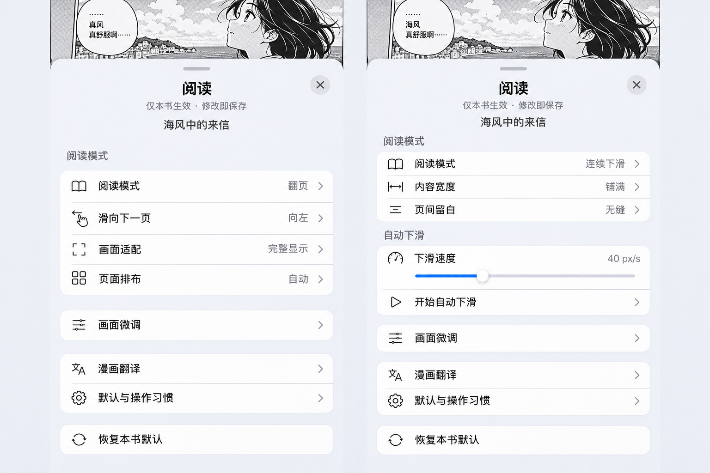
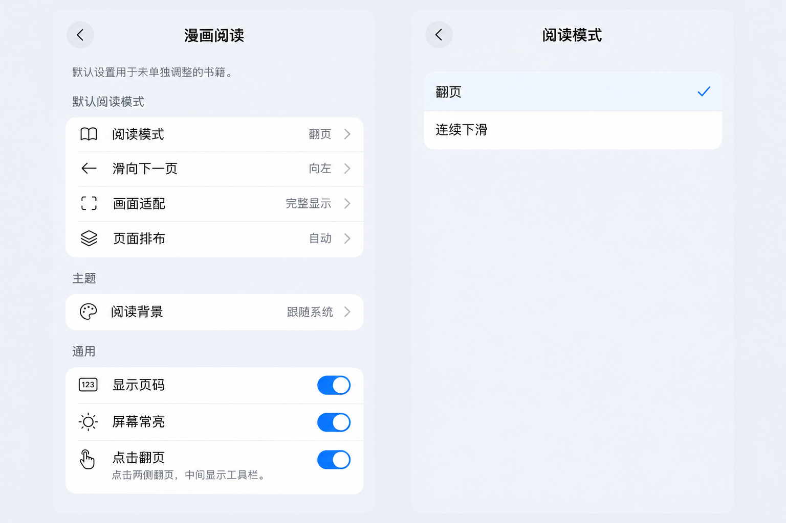

# 漫画阅读设置

漫画阅读器现使用两种主模式：**翻页、连续下滑**。左右／上下作为翻页方向；单双页作为布局。工具栏保留“章节、原图／译图、阅读”三个入口。阅读面板与全局漫画阅读页参考现有小说阅读器，复用分组、带当前值的选择行、选择页、开关及滑块。翻译的界面、交互、会话状态和服务调度保持原样。

新设置独立保存，不读取、不转换旧漫画设置。原来的漫画设置面板、显示快捷面板、滤镜配置、导航布局和闪烁实现已移除。小说仍需要的共享旧字段仅供小说使用，不作为漫画的兼容路径。

## 生图设计参考

两张图由 OpenAI 官方 API 的 `gpt-image-2.6-sunburst` 生成，使用本机 imagegen CLI；图中漫画与书名为虚构示例，没有导入外部漫画、字体或图标。生成图只用于设计参考，不是运行截图，也不是运行时切图素材。应用继续使用已有字体、图标和许可声明。

实际实现以本文和代码为准：不增加翻译新界面，不提供单项继承标记或撤销弹条；“恢复本书默认”清除本书覆盖。滑块松手时保存并应用，拖动时更新数值。提示词：[阅读面板](01-reading.prompt.txt)、[全局设置与选择页](02-scope.prompt.txt)。

## 原设置是否生效

盘点口径为**去重后的可调值**，同一设置出现在两个入口只算一次，模式内部的七个选项也不各算一个设置。共 **49 项：46 项阅读设置与 3 项翻译设置**。

49 项均能找到读取或执行路径，并非 49 项都在所有模式下正确工作。其中 **17 项存在适用条件、语义不一致或已确认故障**，见下表标记“受限／异常”的项目；其余 32 项未发现明显断路。这是代码与局部运行验证的结论，不能理解成 32 项已通过全部图片格式、设备和真实服务验收。“有用”按具体阅读目的判断，没有使用率数据，不能以此声称用户从不使用某个功能。

| 编号 | 旧设置 | 原有生效情况 | 用途与当前处理 |
| --- | --- | --- | --- |
| 1 | 默认阅读模式 | 有读写路径；进入一本书后可能被自动写入的单书值遮住 | 有用。改为四项默认模板，进入阅读不再生成覆盖 |
| 2 | 本书阅读模式 | 七种模式均有分流，组合行为不全相同 | 核心。收敛为翻页／连续下滑，方向独立选择 |
| 3 | 单页／双页 | 有分组与呈现路径 | 有用。与自动双页合成“自动／单页／双页” |
| 4 | 缩放方式 | **受限／异常**：“拉伸”静态图实际裁切，GIF 路径则会变形 | 保留完整显示、适合宽度、适合高度；删拉伸及不可选的遗留分支 |
| 5 | 背景颜色 | **受限／异常**：连续阅读已加载图片的留白未采用背景 | 有用。统一注入单页、双页与连续画布；修复双页内部黑底覆盖 |
| 6 | 裁边 | **受限／异常**：格式和缓存路径不一致，缓存可能保留旧裁边结果 | 有用。裁边缓存区分开关，静态图重新载入，GIF 使用首帧边界 |
| 7 | 拆分宽页 | **受限／异常**：连续渲染忽略半页裁切，出现两次整图 | 有用但只适合分页单页。改为展示投影，连续模式不提供 |
| 8 | 拆页顺序反转 | **受限／异常**：已拆出的页槽使切换／关闭不可靠 | 取消独立设置，随阅读方向重新投影，不改原始页列表 |
| 9 | 自动旋转宽页 | **受限／异常**：双页路径不采用该设置 | 保留在单页“宽幅跨页”中，与拆页互斥 |
| 10 | 宽页旋转反转 | **受限／异常**：同样依赖实际渲染路径 | 取消持久设置，宽页统一旋转 90°；保留已有单图操作 |
| 11 | 双页首页独立 | 有配对路径 | 有用。仅实际双页显示“封面单独显示”，按章首张处理 |
| 12 | 横屏自动双页 | **受限／异常**：与手动单双页、模式和位置换算相互影响 | 与布局合并；按可用宽度而非单看横屏决定 |
| 13 | 横屏自动缩放 | **受限／异常**：触发条件及更新时机不一致 | 移除。使用等比适配或主动缩放，避免突然放大 |
| 14 | 自动缩放起点 | **受限／异常**：依赖自动缩放是否进入相应路径 | 采用适配后的默认居中位置，取消选择项 |
| 15 | 禁止缩到适配尺寸以下 | 有比例限制路径 | 固定为适配尺寸下限 |
| 16 | 双击缩放开关 | 有手势路径 | 固定开启；静态单页、双页与连续视口保留缩放 |
| 17 | 页面间隙 | **受限／异常**：条漫路径固定为零，开关无效 | 连续下滑统一为无／少量（8 逻辑像素） |
| 18 | 两侧填充百分比 | **受限／异常**：上限各 50% 可以把图片挤成零宽 | 改为满宽／适中／窄幅：100%／92%／84% |
| 19 | 反色 | 有滤镜执行路径 | 有实际阅读用途，保留为本书设置 |
| 20 | 灰度 | 有滤镜执行路径 | 能生效，但属于附加图像效果；移除 |
| 21 | 亮度 | 有滤镜执行路径 | 保留图像亮度 -50%～50%，不改变系统亮度 |
| 22 | 对比度 | 有滤镜执行路径 | 保留 50%～150%，提供恢复原图效果 |
| 23 | 饱和度 | 有滤镜执行路径 | 附加图像效果，移除 |
| 24 | 自定义颜色滤镜启用 | 有执行路径 | 自由配色增加组合与理解成本，移除 |
| 25 | 滤镜 R 通道 | 有执行路径 | 随自定义滤镜移除 |
| 26 | 滤镜 G 通道 | 有执行路径 | 随自定义滤镜移除 |
| 27 | 滤镜 B 通道 | 有执行路径 | 随自定义滤镜移除 |
| 28 | 滤镜 Alpha 通道 | 有执行路径 | 随自定义滤镜移除 |
| 29 | 滤镜混合模式 | **受限／异常**：“无”映射为 srcIn，并非不混合 | 随自定义滤镜移除 |
| 30 | 页码显示 | 有覆盖层路径 | 保留为所有漫画共用习惯 |
| 31 | 屏幕常亮 | **受限／异常**：主要在进入时读取，中途改动不即时响应 | 保留并监听变化；生命周期协调启停 |
| 32 | 预加载页数 | 有资源窗口路径 | 资源策略自动管理，取消用户页数设置 |
| 33 | 自动滚动开关 | **受限／异常**：水平连续的初始化／恢复会被纵向判断暂停 | 改成连续下滑的本次操作，初始停止 |
| 34 | 自动滚动速度 | 有速度路径 | 保留 10～100 逻辑像素／秒；记忆速度不自动启动 |
| 35 | 翻页动画开关 | 有执行路径 | 使用短过渡并尊重系统减少动态效果 |
| 36 | 双击动画速度 | **受限／异常**：部分控制器只初始化时读取 | 固定短过渡，尊重减少动态效果 |
| 37 | 点击区域翻页开关 | 有手势路径 | 保留所有漫画共用总开关，中间仍可开关工具栏 |
| 38 | 点击导航布局 | 有分区路径 | 固定前／中／后三分区，避免六种分区选择 |
| 39 | 点击区域反转 | 有映射路径 | 跟随当前翻页方向 |
| 40 | 工具栏隐藏阈值 | 有滚动判断路径 | 固定规则，取消像素档位 |
| 41 | 进入时显示导航区域 | 有覆盖层路径 | 删除启动覆盖；操作习惯页用简短文字说明 |
| 42 | 导航时先平移 | **受限／异常**：平移判断仅覆盖横向分页 | 横向放大时自动先平移到边缘；无独立开关 |
| 43 | 闪烁启用 | 有闪屏覆盖层路径 | 移除；没有证据支持其防烧屏用途 |
| 44 | 闪烁颜色 | 有执行路径 | 随闪烁移除 |
| 45 | 闪烁间隔 | 有定时路径 | 随闪烁移除 |
| 46 | 闪烁时长 | 有定时路径 | 随闪烁移除 |
| 47 | 原图／译图 | 有既有会话和显示路径 | 保持原工具栏按钮与行为 |
| 48 | 自动翻译 | 有既有调度路径 | 保持原翻译面板与行为 |
| 49 | 目标语言 | 有既有共享偏好和任务路径 | 保持原翻译面板与行为 |

## 七个模式的去向

| 原模式 | 原来真实差别 | 当前入口 |
| --- | --- | --- |
| 垂直 | 纵向 PageView 分页 | 翻页 → 向上 |
| 从左到右 | 横向 PageView | 翻页 → 向左 |
| 从右到左 | 同一 PageView 反向 | 翻页 → 向右 |
| 垂直连续 | 纵向列表，点击按图片前进，可带间隙 | 连续下滑；点击前进约 60% 可视高度，避免跨过长图剩余内容 |
| 网络漫画／条漫 | 同一纵向列表，点击按视口前进，固定无间隙 | 与垂直连续合并；页间留白独立选择 |
| 水平连续 | 横向列表；自动滚动恢复条件不一致 | 移除 |
| 水平连续 RTL | 同一横向列表反向；相同恢复问题 | 移除 |

删除横向连续是减少组合和维护面的产品取舍，不声称其完全不能滚动或无人使用。没有旧模式映射、首次迁移提示、旧值回退和双份设置来源。

## 设置范围与使用方式

可调值收敛为 **25 项**：12 个本书字段、4 个默认模板字段、4 个操作习惯、2 个自动下滑操作，以及保持不变的 3 个翻译设置。章节管理和图片保存等动作不计入此数。

| 范围 | 字段 | 影响 |
| --- | --- | --- |
| 本书：基础四项 | 阅读模式、滑向下一页、画面适配、页面排布 | 只保存明确修改的字段；其余继续继承默认模板 |
| 本书：画面八项 | 裁边、宽幅跨页、封面独立、反色、图像亮度、对比度、阅读宽度、页间留白 | 限当前漫画 ID，跨章节保留；没有覆盖时采用应用初始值 |
| 全局默认：四项 | 阅读模式、滑向下一页、画面适配、页面排布 | 只影响未覆盖对应字段的书；不强制覆盖所有书 |
| 操作习惯：四项 | 背景、页码、常亮、点击翻页 | 所有漫画共用；当前阅读即时响应 |
| 自动下滑：两项 | 开始／暂停、速度 | 运行状态限当前阅读会话；只记忆速度 |
| 翻译：三项 | 原图／译图、自动翻译、目标语言 | 保留现有设计及作用范围 |

进入阅读、切章节、旋转或加载图片不会创建本书覆盖。“恢复本书默认”仅删除当前书的覆盖，不修改其他书、全局模板和翻译；“恢复原图效果”只重置反色、亮度、对比度。

主面板按场景显示相关控件：翻页提供模式、方向、适配、布局四行；连续下滑提供模式、宽度、间距三行和自动下滑组。全局默认模式也隐藏当前不适用的选项，隐藏不会清除其已保存值。向上翻页固定单页，隐藏单双页选项。画面微调在主面板内展开；默认与操作习惯在同一弹层切换内容，带返回和关闭。离散选项进入小说阅读器共用的选择页，返回取消或选择同值不写入。

页面外观统一由 `NodeLaneTokens` 和现有共享组件提供：`MobileSettingsGroup`、`MobileSettingsChoice`、`NodeLaneDisclosure`、`NodeLaneSwitchRow`、`NodeLaneSliderRow`。选择行显示图标、标题、右侧当前值和箭头；背景选择使用实际颜色样例。没有漫画专用主题覆盖、模式插图卡片或大面积深蓝分段按钮。字体、字号、间距、圆角、亮暗主题与其他设置保持一致，强调色只用于共用控件的启用和选择反馈。

离散选项保存成功后生效，滑块松手后保存；失败显示“无法保存，请重试”并保留已保存的值。关闭不撤销。打开设置暂停自动下滑，关闭后仍暂停；点击“开始”立即更新运行状态并关闭面板。面板和浮动按钮订阅同一份实时状态，不保存关闭后回写的副本；关闭面板本身不重新写入运行状态。进入后台、拖动、打开目录时暂停，返回前台不会自行启动。

## 显示规则

- 默认翻页、向左、完整显示、自动布局。自动布局在可用宽度至少 648 逻辑像素且横向翻页时使用双页；手动双页可覆盖宽度判断。
- 双页按原图配对，宽幅原图独占画面，章首独立可选。切换到向上翻页或连续下滑时暂不应用单双页选择，返回横向翻页后恢复。
- 宽幅跨页仅在分页且有效布局为单页时显示“完整／分开读／旋转”。拆分比例依据原图，顺序随方向；切回完整、改方向或切模式可重新生成，源列表不被拆页修改。双页不再同时拆页或旋转。
- 裁边应用于图片内容。静态图切换裁边重新解析；缓存记录是否已裁边。GIF 用首帧的白／黑／透明边界保持后续帧布局稳定；切换裁边可恢复原图边界，半页使用归一化区域。
- 连续模式始终等比适合宽度，满宽／适中／窄幅为 100%／92%／84%，少量间距为 8 逻辑像素。背景覆盖图片外的全部画布。双页 PhotoView 也明确采用同一背景。
- 原色／反色、亮度、对比度合成一次颜色矩阵；不改变工具栏颜色和翻译状态。默认效果不额外包颜色过滤层。
- 横向分页放大时优先平移，达到边界后翻页；连续模式按视口高度前进。向上分页没有新增图内纵向分段导航。静态单页、双页及连续视口支持缩放；单页 GIF 当前没有独立的捏合缩放手势，不将该格式算作此项完整验收。
- 预取使用既有有界队列，前向窗口固定三页；继续遵循并发、后台暂停、相邻章节与离屏资源释放边界。设置 UI 不解析来源、不调度翻译、不持有图片缓存。

## 实现与删除清单

新模型、持久化、展示作用域和设置 UI 位于 [settings](../../../lib/modules/manga/reader/settings/)。`ComicReaderPreferences` 通过 `Settings.comicReaderPreferences` 保存新命名空间，书籍以漫画 ID 定位。更新通过已有仓库写入队列对最新值做字段修改，避免单书、全局和阅读进度并发写入互相覆盖。备份序列化包含新字段，没有迁移器、版本门禁或旧字段兼容读取。

设置订阅跟随阅读会话存活，不依赖面板开关或 build 重建。运行操作直接更新会话状态；速度、常亮、页码、背景与颜色效果立即应用，不等待页面定位。只有影响几何尺寸或页分组的变更进入视口锚点流程，连续修改合并为最新请求，执行时读取最新配置。阅读模式、方向和单双页均由已应用的配置推导，不另存模式 provider 或多份缓存。初始定位与后续重排共用锚点流程。

渲染器只接收有效配置；模式／拆页／单双页改变通过现有原图身份和视口锚点提交，进度仍按原始图片计数。漫画与小说的偏好控制分离，共享章节行为继续复用。设置页和阅读弹层复用同一内容组件，弹层使用 `NodeLaneCatalogSheet`，设置内容使用小说阅读器共用的 `MobileSettingsGroup`、`MobileSettingsChoice` 与行控件，样式由 `NodeLaneTokens` 统一提供。

**移除 13 个独立旧设置**：灰度、饱和度、自定义颜色滤镜六项（开关、RGBA、混合模式）、闪烁四项（开关、颜色、间隔、时长）、横屏自动放大。

**另 13 个交给固定规则或自动处理**：拆页反转、旋转反转、缩放起点、禁止缩小开关、双击开关、预加载页数、翻页动画开关、双击速度、导航布局、点击反转、隐藏阈值、启动区域覆盖、导航先平移。单双页与自动双页合并；拆页与宽页旋转合并。

此外移除两个横向连续模式、拉伸选项、旧“显示／设置”重复入口、旧三标签设置页和专用选择页，以及相关旧漫画 provider、枚举、字段和生成代码。章节左右滑动动作、重复章节已读移至章节的设置页，保留原能力；小说、动画、下载、来源、书签与翻译没有被删除。

设置外观移除漫画专用的 `ComicSettingOptions` 分段选择封装和独立“画面微调”子面板，不保留两套交互实现。离散选项复用小说设置的选择页，画面参数改为原位展开。

## 验证与边界

- 自动化回归覆盖：新设置继承、单书隔离、并发写入、重新读取、备份序列化、失败保存、无关数据库写入不触发重排；拆页顺序与恢复；中英文、常规与 2.5 倍字号；章节和视口锚点；既有翻译窗口与重试测试。
- 设置外观在 iOS 模拟器核对阅读弹层、画面微调展开、默认与操作习惯、导航中的漫画阅读页及共用选择页；返回选择页不改变当前值。大字号和保存失败由组件测试覆盖。
- 完整阅读器 widget 测试检查真实滚动距离的开始／立即停止；拖动期间布局等待时，颜色、常亮和页码仍立即更新；后台多次修改只应用最后的布局，恢复前台不会重启自动下滑。平台常亮与翻译使用替身，设置持久化另由临时数据库测试覆盖。
- 像素验证覆盖：连续宽度与间距、画布颜色、反色；双页背景即时切换；多帧图片的边界裁切、左右半页切换、关闭裁边和自然高度。多帧测试使用确定性帧流，不替代全部真实 GIF 解码验收。
- iOS 模拟器使用已有下载漫画验证：第 4 页切连续仍为第 4 页，宽度与间距可见变化，自动下滑可启动与暂停；运行中打开设置立即停止，关闭面板后画面保持不动，浮动暂停按钮也直接停止且无需重开设置；双页显示 4–5／21 且留白使用当前背景；反色生效；恢复本书默认回到第 4 页和原色，重启后仍可恢复第 4 页。原翻译面板入口已核对，未修改其选择。测试修改已恢复。新工具栏和两层弹层可操作。
- iOS 按指定模拟器构建并运行通过，Android Debug APK 构建通过。静态分析无新增问题，仍有原有翻译生成代码警告和提示。通用 iOS 模拟器构建曾在 media_kit_video 的 Swift 架构组合处失败，指定模拟器构建可用；没有以此声称 Release／CI 通过。
- 尚需验收：iOS／Android 真机、Android 交互、平板横竖屏完整组合、真实翻译服务、所有在线／本地／压缩包与动态图格式、完整读屏和性能耗电。没有调用真实翻译服务做计费验收。
